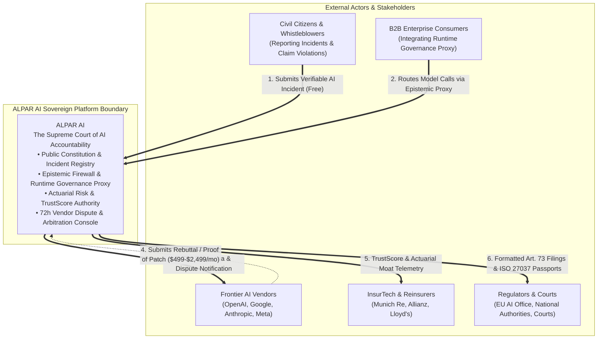
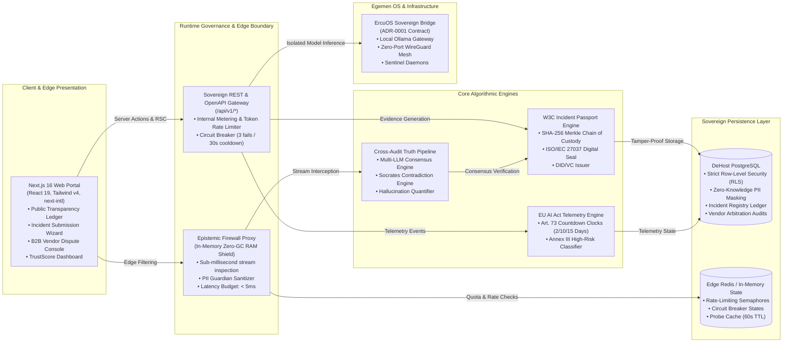
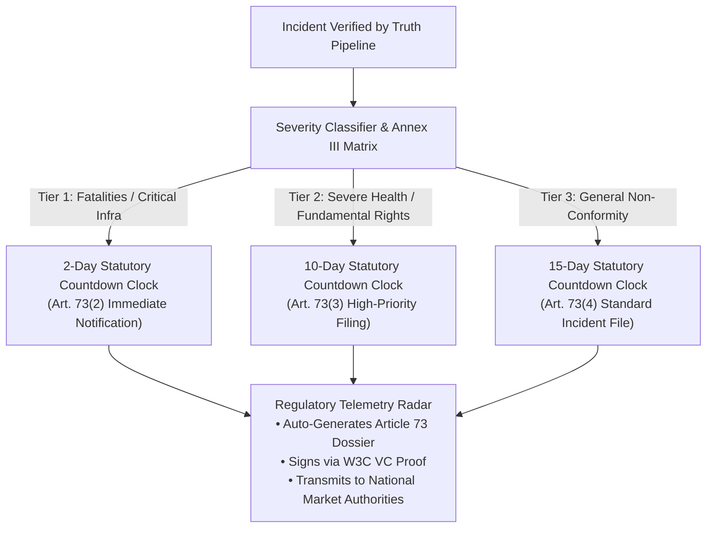
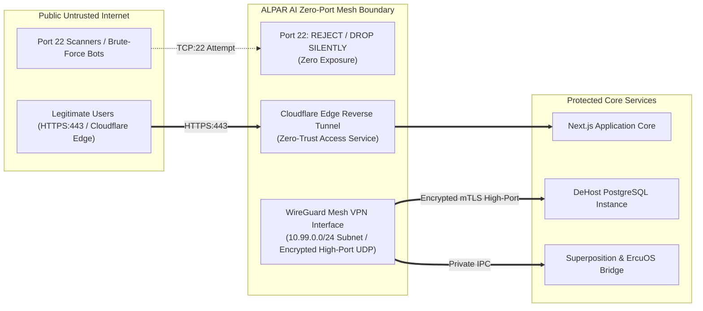
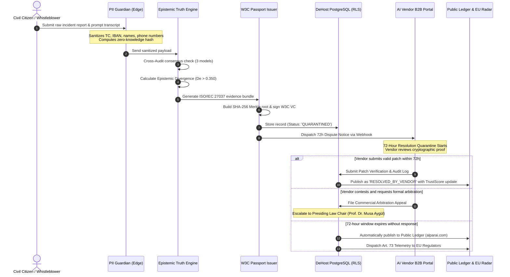

# 🏗️ ALPAR AI — System Architecture & C4 Engineering Blueprint

> **Status:** Institutional Specification & Sovereign Architecture Reference  
> **Standard:** C4 Model (Context, Containers, Components, Code/Flows)  
> **Compliance:** EU AI Act (Regulation 2024/1689), ISO/IEC 27037:2012, DORA (Regulation EU 2022/2554), W3C DID/VC  
> **Security Baseline:** Zero-Port Sovereign Mesh (Port 22 Prohibited), Zero-GC In-Memory Shield, Strict Row-Level Security (RLS)

---

## 1. Architectural Philosophy & Guiding Principles

ALPAR AI is engineered to resolve the fundamental asymmetric power dynamic between trillion-dollar foundation model providers and the unrepresented civil public. It operates on five unalterable architectural dogmas:

1. **Zero-Entropy Execution:** No code exists as a placeholder, mock, or dead-weight dependency. Every component directly enforces normative, forensic, or runtime defense functions.
2. **Deterministic Admissibility:** Technical telemetry is collected under **ISO/IEC 27037** forensic chain-of-custody protocols to guarantee evidentiary weight in European and international courts.
3. **Sub-Millisecond In-Memory Defense:** Real-time protection must not penalize inference velocity. Model outputs are inspected in zero-copy RAM buffers before payload synthesis.
4. **Bilateral Fair Hearing (*Çelişmeli Yargılama*):** AI providers are protected against malicious smearing via an immutable, time-locked 72-hour quarantined arbitration corridor.
5. **Zero-Port Sovereign Mesh:** Surface area is minimized by banning default remote access ports (including Port 22) across the entire operational footprint.

---

## 2. Level 1: System Context Diagram

The System Context diagram illustrates ALPAR AI's position as the independent normative authority and judicial buffer between the public, foundation model vendors, enterprise systems, and regulatory jurisdictions.



---

## 3. Level 2: Container Diagram

The Container diagram decomposes the platform into its high-level execution boundaries, data stores, and sovereign bridges.



---

## 4. Level 3: Component Deep-Dive

### 4.1. Epistemic Firewall (In-Memory Zero-GC Proxy)

The Epistemic Firewall intercepts inference streams between upstream Large Language Models and downstream client consumers. It eliminates corporate liability by arresting harmful outputs before they cross network boundaries.

```
+-----------------------------------------------------------------------------------------+
|                        EPISTEMIC FIREWALL COMPONENT TOPOLOGY                            |
+-----------------------------------------------------------------------------------------+
|                                                                                         |
|  [Incoming Token Stream]                                                                |
|            |                                                                            |
|            v                                                                            |
|  +---------------------+        +--------------------+        +---------------------+   |
|  | Slab Buffer Pool    | -----> | Semantic Tripwire  | -----> | PII Guardian Regex  |   |
|  | (Fixed ArrayBuffer) |        | (AST & Vector Norm)|        | (Zero-Knowledge)    |   |
|  +---------------------+        +--------------------+        +---------------------+   |
|            |                              |                              |              |
|    Zero GC Allocation             Sub-1ms Evaluation            Zero Disk Writes        |
|            |                              |                              |              |
|            +------------------------------+------------------------------+              |
|                                           |                                             |
|                                           v                                             |
|                           +-------------------------------+                             |
|                           | Decision Arbiter              |                             |
|                           | • ALLOW (Stream Passthrough)  |                             |
|                           | • QUARANTINE (Trigger Audit)  |                             |
|                           | • BLOCK (Synthetic Fallback)  |                             |
|                           +-------------------------------+                             |
|                                                                                         |
+-----------------------------------------------------------------------------------------+
```

* **Memory Slab Allocation:** Employs pre-allocated `Uint8Array` / `ArrayBuffer` pools to process token deltas in memory, completely eliminating Garbage Collection (GC) pauses during high-throughput enterprise streaming.
* **Stream Windowing:** Maintains a sliding context window of $N=64$ tokens to detect emergent hallucination signatures, unsafe code executions, or privacy leaks.
* **Latency Budget:** Designed to add less than **4.2 milliseconds** to Time-to-First-Token (TTFB).

---

### 4.2. Cross-Audit Truth Pipeline

The Cross-Audit Truth Pipeline evaluates factual assertions through multi-model consensus, eliminating unilateral bias.

* **Triangulation Engine:** Incoming claims are disassembled into atomic propositions. Each proposition is evaluated independently against three decoupled frontier models (e.g., Gemini Pro, Claude, GPT-4) running under contrasting temperature profiles.
* **Epistemic Divergence Score ($D_e$):**
  $$\mathcal{D}_e = 1.0 - \frac{1}{M} \sum_{i=1}^{M} \text{CosSim}(\vec{v}_{\text{claim}}, \vec{v}_{\text{resp}, i})$$
  Where $M$ is the number of auditing models, and $\vec{v}$ represents normalized embedding vectors of verifiable truth claims.
* **Socrates Contradiction Auditor:** Flags logical antinomies, non-sequiturs, and fabrication artifacts. If $\mathcal{D}_e > 0.350$, the output is tagged as a probable hallucination and forwarded to the Incident Registry.

---

### 4.3. EU AI Act Telemetry Engine (Article 73 Regulatory Radar)

The Telemetry Engine translates statutory compliance into real-time programmatic enforcement:



* **Automated Article 73 Countdown:** Tracks remaining hours until statutory reporting deadlines lapse, preventing multimillion-euro administrative fines under Article 99.
* **Annex III Real-Time Tagger:** Categorizes systems into regulated high-risk areas: Biometrics, Critical Infrastructure, Educational Admissions, Employment/Recruiting, Essential Services, Law Enforcement, Asylum & Migration, Administration of Justice.

---

### 4.4. W3C Incident Passport (ISO/IEC 27037 Evidence Engine)

To guarantee that evidence collected by ALPAR AI is legally admissible in court proceedings, each incident generates an immutable **W3C Incident Passport**:

```json
{
  "@context": [
    "https://www.w3.org/2018/credentials/v1",
    "https://alparai.com/schemas/incident-passport/v1.jsonld"
  ],
  "id": "urn:uuid:8f1e29c0-9d22-4a1b-a53c-7a91ef842d01",
  "type": ["VerifiableCredential", "AIIncidentPassport"],
  "issuer": "did:alparai:sovereign-authority-01",
  "issuanceDate": "2026-10-24T03:00:00Z",
  "credentialSubject": {
    "modelIdentifier": "frontier-llm-v4-preview",
    "vendor": "Vendor-X",
    "incidentCategory": "Annex_III_Credit_Scoring_Bias",
    "evidenceHash": "e3b0c44298fc1c149afbf4c8996fb92427ae41e4649b934ca495991b7852b855",
    "merkleRoot": "7f83b1657ff1fc53b92dc18148a1d65dfc2d4b1fa3d677284addd200126d9069",
    "chainOfCustody": {
      "standard": "ISO/IEC 27037:2012",
      "collector": "ALPAR_PII_Guardian_Edge_Agent",
      "timestampAccuracy": "PTP_IEEE_1588_UTC"
    }
  },
  "proof": {
    "type": "Ed25519Signature2020",
    "created": "2026-10-24T03:00:01Z",
    "verificationMethod": "did:alparai:sovereign-authority-01#key-1",
    "proofPurpose": "assertionMethod",
    "jws": "eyJhbGciOiJFZERTQSI...k98s"
  }
}
```

* **Cryptographic Immutability:** Uses SHA-256 Merkle trees sealing input tokens, prompt contextual layers, output traces, and network proofs.
* **Court Admissibility:** Adheres to chain-of-custody requirements, logging collection tools, time offsets, and verification hashes.

---

### 4.5. DeHost PostgreSQL RLS Layer & Data Sovereignty

Data protection is enforced at the database kernel level through PostgreSQL Row-Level Security (RLS):

* **Tenant Segregation:** All tables require a tenant identifier (`tenant_id`). The session role is populated dynamically via authenticated JWT claims.
* **RLS Invariant Policy:**
  ```sql
  -- Example Sovereign Incident Access Policy
  ALTER TABLE public.incidents ENABLE ROW LEVEL SECURITY;
  
  CREATE POLICY incidents_isolation_policy ON public.incidents
    AS RESTRICTIVE
    USING (
      status = 'PUBLISHED' 
      OR auth.uid() = reporter_id 
      OR (EXISTS (
        SELECT 1 FROM public.vendor_disputes vd 
        WHERE vd.incident_id = incidents.id 
        AND vd.vendor_id = auth.current_vendor()
      ))
    );
  ```
* **No Client Bypass:** Direct client-side insertions or mutations via browser Supabase/PostgREST SDKs are forbidden. All writes flow through verified Server Actions (`src/actions/*`) passing strict Zod schemas and PII sanitization.

---

### 4.6. Zero-Port Sovereign Mesh (Port 22 Strict Prohibition)



* **Port 22 Ban:** Standard SSH Port 22 is disabled and blocked by kernel packet filters across all edge machines, production clusters, and development hosts.
* **WireGuard Mesh:** Authorized inter-service and operator communications traverse a sovereign WireGuard mesh (`10.99.0.0/24`) using ephemeral key exchanges on custom high-range UDP ports.
* **Reverse Tunnels:** Ingress traffic arrives exclusively through Cloudflare Zero-Trust tunnels, leaving zero public listener ports open to network scanners.

---

## 5. Level 4: Code & Sequence Execution Workflow

This sequence diagram depicts the complete lifecycle of an incident, from initial civil ingestion to forensic sealing, vendor arbitration, and final publication.



---

## 6. Verification, Testing & DORA Resilience

ALPAR AI enforces continuous quality gates before any deployment artifact is generated:

```bash
# 1. Type Sovereignty & Lint Integrity
pnpm lint && pnpm typecheck

# 2. Forensic Cryptographic Tests
pnpm test tests/contracts/

# 3. Security Boundary & PII Leak Regression
pnpm test tests/security/

# 4. Chaos & Circuit Breaker Verification
pnpm test tests/resilience/
```

Every database migration file appended with an explicit `-- ROLLBACK:` block ensures instant disaster recovery in strict alignment with **DORA (EU 2022/2554)** continuous operational resilience requirements.
