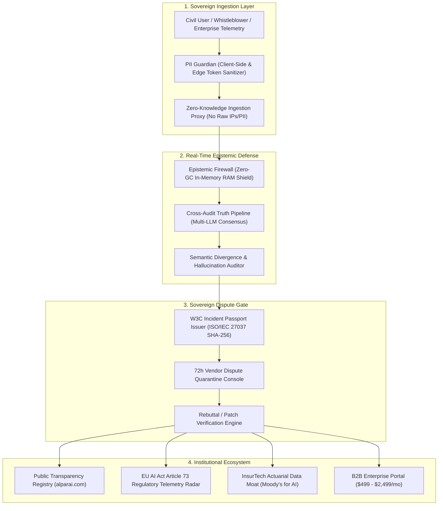

# 🏛️ ALPAR AI — The Supreme Court of AI Accountability & Trust

[🇬🇧 English](./README.md) | [🇹🇷 Türkçe](./README.tr.md)

[](https://alparai.com)
[](./LICENSE)
[](https://eur-lex.europa.eu/legal-content/EN/TXT/?uri=CELEX:32024R1689)
[](https://www.iso.org/standard/43838.html)
[](https://eur-lex.europa.eu/legal-content/EN/TXT/?uri=CELEX%3A32022R2554)
[](https://www.w3.org/TR/vc-data-model/)
[](https://nextjs.org/)
[](https://react.dev/)
[](https://www.typescriptlang.org/)

---

## Executive Summary

**ALPAR AI** is the world's premier independent sovereign governance authority, judicial registry, and runtime trust infrastructure for artificial intelligence. Operating at the intersection of international private law, cryptographic computer forensics (**ISO/IEC 27037**), and statutory compliance (**EU AI Act Regulation 2024/1689** / **DORA EU 2022/2554**), ALPAR AI serves as the societal immune system against unverified frontier models, algorithmic harms, and corporate hallucination liabilities.

Rooted in Istanbul Teknopark and structured under Swiss/international commercial arbitration norms, ALPAR AI establishes an unassailable **Third Global Judicial Forum** bridging the geopolitical divide between US proprietary tech cartels and Chinese sovereign LLM ecosystems.

```
       +-------------------------------------------------------------+
       |                        CIVIL SOCIETY                        |
       |     Users, Whistleblowers, Engineers, Impacted Citizens     |
       +------------------------------+------------------------------+
                                      | Free Incident Ingestion
                                      v
       +-------------------------------------------------------------+
       |                          ALPAR AI                           |
       |  The Sovereign Hub: Epistemic Firewall & Incident Registry  |
       +--------------+-------------------------------+--------------+
                      |                               |
       72h Vendor     |                               | Actuarial Risk Data
       Dispute Gate   v                               v (Moat Licensing)
+-------------------------------+      +-------------------------------+
|       FRONTIER VENDORS        |      |      INSURTECH & REINSURERS   |
| OpenAI, Anthropic, Google, AI |      | Munich Re, Allianz, Lloyd's   |
| ($499 - $2,499/mo B2B Portal) |      | (Underwriting AI Liability)   |
+-------------------------------+      +-------------------------------+
```

---

## 🏛️ The 4 Core Architectural Pillars

### 1. Public Constitution & Incident Registry (3,115+ Verified Cases)
* **Democratic Norm Setting:** Rules of engagement must not be authored exclusively by trillion-dollar monopolists or state intelligence agencies. The civil population directly establishes normative boundaries through crowdsourced evidence.
* **Empirical Data Moat:** Built upon an exhaustive forensic corpus of over **3,115+ independently verified incident records** cataloged across 24+ global frontier foundation models.
* **Court Admissibility:** Every incident is frozen at ingestion using SHA-256 Merkle chain-of-custody protocols compliant with **ISO/IEC 27037** forensic digital evidence admissibility standards.

### 2. Epistemic Firewall & Runtime Governance Proxy
* **Zero-GC In-Memory RAM Shield:** Sits in-flight between upstream AI inference providers and downstream enterprise production workers.
* **Sub-Millisecond Stream Interception:** Evaluates token generation velocity, semantic divergence, PII exfiltration vectors, and truth claims in RAM without disk latency.
* **Liability Isolation:** Blocks hallucinated legal advice, rogue financial instructions, or toxic prompt injections before the payload breaches consumer boundaries.

### 3. Actuarial Risk & InsurTech Rating Authority (*Moody's for AI*)
* **Standardized TrustScore™:** An algorithmic credit rating system establishing quantitative risk scores ($0.000$ to $1.000$) for every commercial model deployment.
* **Actuarial Risk Modeling:** Feeds institutional reinsurance syndicates (Munich Re, Swiss Re, Allianz) with real-world probability tables required to underwrite AI Errors & Omissions (E&O) insurance policies.
* **Mandatory Insurance Moat:** Enterprises utilizing high-risk Annex III AI systems cannot qualify for institutional underwriters without an active ALPAR AI TrustScore certificate.

### 4. 72h Vendor Dispute & Sovereign Arbitration Console
* **Adversarial Fairness (*Çelişmeli Yargılama*):** Unilateral public shaming is replaced with high-integrity bilateral arbitration. When an incident is verified, affected foundation model vendors receive an automated cryptographic subpoena.
* **72-Hour Resolution Quarantine:** Vendors possess a time-locked 72-hour window in the enterprise B2B portal to supply proof of patch, submit a counter-audit, or request formal arbitration before public registry publication.
* **Sovereign Legal Precedent:** Chaired by world-renowned jurists, arbitration rulings provide binding legal evidence under international commercial arbitration conventions.

---

## ⚡ Architectural Blueprint



---

## 🌐 International Compliance & Legal Matrix

| Regulation / Standard | Jurisdiction / Body | Statutory Requirement | ALPAR AI Architectural Enforcement |
| :--- | :--- | :--- | :--- |
| **EU AI Act (2024/1689) Art. 73** | European Union | Mandatory Serious Incident Reporting: **2-day** (fatalities/critical infrastructure), **10-day** (severe health/fundamental rights), **15-day** (general). | **Autonomous Regulatory Telemetry Radar:** Automates strict countdown clocks, categorizes incident severity, and formats standardized Article 73 filings. |
| **EU AI Act (2024/1689) Annex III** | European Union | Mandatory conformity and post-market tracking for High-Risk AI deployments (Biometrics, Critical Infra, HR, Justice). | **High-Risk Domain Classifier:** Flags incoming model calls and incidents against Annex III taxonomy with real-time compliance alerting. |
| **ISO/IEC 27037:2012** | Global / Forensic Bodies | Digital evidence handling, forensic preservation, cryptographic authenticity, chain of custody. | **W3C Incident Passport:** SHA-256 Merkle trees sealing input tokens, model checkpoints, timestamps, and network proofs into tamper-evident legal records. |
| **DORA (EU 2022/2554)** | Financial / Banking Regulators | ICT-related risk management, operational resilience, vendor concentration vulnerability testing. | **Runtime Resilience Proxy:** Zero-latency circuit breakers, fallback arbitration, and live stress-testing of upstream AI dependencies. |
| **W3C Verifiable Credentials** | W3C / Open Web | Cryptographically verifiable, decentralized claims architecture. | **Decentralized Incident Badges (DID/VC):** Verifiable proofs issued directly to whistleblowers, corporate victims, and regulatory auditors. |

---

## 👥 Sovereign Leadership & Arbitration Council

The institutional legitimacy of ALPAR AI is rooted in a triad of technical mastery, academic legal doctrine, and investigative media authority:

* **Founder & Chief Technology Architect (CTO):**  
  **Ercüment Erden** | [ercumenterden.com](https://ercumenterden.com)  
  *Email:* `ercument.erden@alparai.com` | *Phone:* `+90 (532) 440-83-89`  
  *Mandate:* Sole Founder, Core Systems Architect, inventor of the Epistemic Firewall, Zero-Port Sovereign Mesh, and ZKP autonomous audit infrastructure.
* **Chair of Law & Sovereign Arbitration:**  
  **Prof. Dr. Musa Aygül** | [musaaygul.com](https://musaaygul.com)  
  *Institutional Title:* Chair of Commercial Law, Faculty of Law, Selçuk University; World Authority in Private International Law (MÖHUK) and International Commercial Arbitration.  
  *Mandate:* Highest academic patron and presiding judicial authority ensuring strict compliance with EU AI Act, W3C Incident Passports, and global arbitral enforcement.
* **Public Opinion & Strategic Media Lead:**  
  **Ahmet Rıfat Albuz** | [ahmetrifatalbuz.com](https://ahmetrifatalbuz.com)  
  *Mandate:* Veteran investigative journalist (20+ years experience), spearheading transparent public awareness, corporate naming-and-shaming governance, and civil crisis communications.

---

## 🚀 Quickstart

### Prerequisites
* **Node.js:** `>= 20.0.0`
* **Package Manager:** `pnpm >= 9.12.0`
* **Database:** DeHost PostgreSQL with Row-Level Security (RLS) enabled
* **Network Rule:** Port 22 is strictly disabled across all deployment environments

### 1. Repository Setup
```bash
# Clone the repository
git clone https://github.com/quantummatrixcore-lab/alparai.git
cd alparai

# Install strictly locked dependencies
pnpm install
```

### 2. Environment Configuration
```bash
cp .env.example .env.local
# Configure your DeHost PostgreSQL credentials, Sovereign Bridge secrets, and encryption salts
```

### 3. Local Crucible Verification
Before executing code or proposing mutations, run the mandatory verification pipeline:
```bash
# Static analysis and type safety
pnpm lint
pnpm typecheck

# Unit and contract tests
pnpm test

# Full validation pass
pnpm validate
```

### 4. Running the Development Server
```bash
pnpm dev
# Open http://localhost:3000 in your browser
```

---

## ⚖️ Open-Core vs. Managed B2B Tiers

ALPAR AI operates as an open-core, dual-sided B2B RegTech & Cybersecurity enterprise:

| Feature / Capability | Open-Core Community (AGPL-3.0) | Managed B2B & InsurTech Tier |
| :--- | :---: | :---: |
| **Public Incident Reporting** | ✅ Unrestricted Free Ingestion | ✅ Direct API Webhooks & SDKs |
| **W3C Incident Passport** | ✅ Standard SHA-256 Hashes | ✅ Notarized Multi-Sig Legal Affidavits |
| **Core Epistemic Firewall** | ✅ Single-Node In-Memory Engine | ✅ Distributed Global Zero-GC Edge Mesh |
| **Vendor Dispute Console** | ❌ Read-Only Public Ledger | ✅ **72h Time-Locked Resolution Portal** |
| **B2B Dispute Subscription** | ❌ N/A | ✅ **\$499 – \$2,499 / month** |
| **EU AI Act Telemetry Engine** | ❌ Manual Reference Only | ✅ Automated Art. 73 Regulatory Filings |
| **Moody's for AI Data Moat** | ❌ N/A | ✅ Full Actuarial Risk Licensing for Insurers |
| **Custom SLA & Incident Defense** | ❌ Community Support | ✅ 24/7 Dedicated Legal & SRE Concierge |

---

## 🛡️ Security, Privacy & Network Sovereign Policy

1. **Port 22 Absolute Ban:**  
   Port 22 is globally vulnerable and prohibited across all internal infrastructure, remote machines, and CI/CD agents. Remote ingress is exclusively permitted over WireGuard Mesh VPNs (`10.99.0.0/24`), Cloudflare Zero-Trust tunnels, or authenticated high-port mTLS proxies.
2. **Zero-Knowledge PII Ingestion:**  
   No unhashed national identification numbers, credit card data, email addresses, or unencrypted IP addresses are ever written to database logs or persistence layers. The **PII Guardian** sanitizes all telemetry at the client boundary.
3. **Database Sovereignty (RLS):**  
   Every table is secured by DeHost PostgreSQL Row-Level Security (RLS) policies. Client-side database modifications are strictly prohibited; all state mutations route through authenticated Server Actions.
4. **Responsible Disclosure:**  
   Security vulnerabilities must be reported directly to `security@alparai.com`. Reports are acknowledged within 24 hours in accordance with our ISO/IEC 29147 coordinated disclosure policy.

---

## 📄 License & Attribution

ALPAR AI Open-Core is licensed under the **GNU Affero General Public License v3.0 (AGPL-3.0)**.  
Copyright © 2026 ALPAR AI Organization. Built with sovereign precision at Teknopark Istanbul.
