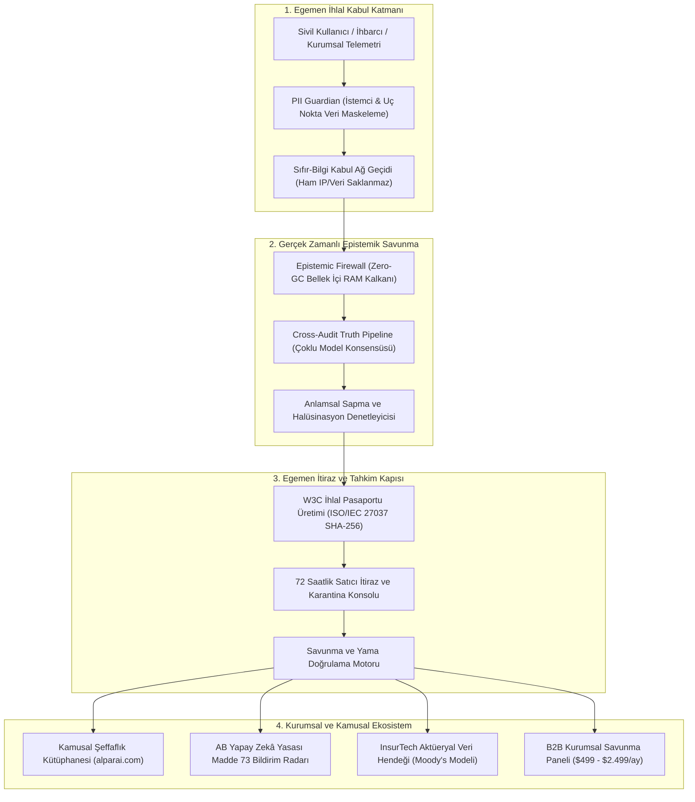

# 🏛️ ALPAR AI — Yapay Zekâ Hesap Verebilirlik ve Güven Yüksek Mahkemesi

[🇬🇧 English](./README.md) | [🇹🇷 Türkçe](./README.tr.md)

[](https://alparai.com)
[](./LICENSE)
[](https://eur-lex.europa.eu/legal-content/EN/TXT/?uri=CELEX:32024R1689)
[](https://www.iso.org/standard/43838.html)
[](https://eur-lex.europa.eu/legal-content/EN/TXT/?uri=CELEX%3A32022R2554)
[](https://www.w3.org/TR/vc-data-model/)
[](https://nextjs.org/)
[](https://react.dev/)
[](https://www.typescriptlang.org/)

---

## Yönetici Özeti

**ALPAR AI**, yapay zekâ ekosistemi için dünyanın ilk bağımsız egemen yönetişim otoritesi, adli sicil kayıt kütüphanesi ve çalışma zamanı (runtime) güven altyapısıdır. Milletlerarası özel hukuk, kriptografik adli bilişim (**ISO/IEC 27037**) ve yasal düzenlemelerin (**AB Yapay Zekâ Yasası - EU AI Act 2024/1689** / **DORA EU 2022/2554**) kesişim noktasında çalışan ALPAR AI; doğrulanmamış sınır modellerine, algoritmik zararlara ve kurumsal halüsinasyon risklerine karşı **Toplumsal Bağışıklık Sistemi** vazifesi görür.

Teknopark İstanbul merkezli olarak yapılandırılan ve uluslararası ticari tahkim normlarıyla tahkim edilen ALPAR AI; ABD teknoloji tekelleri ile Çin egemen yapay zekâ ekosistemleri arasındaki küresel rekabette tarafsız ve bağımsız bir **3. Küresel Hakemlik Zeminidir.**

```
       +-------------------------------------------------------------+
       |                        SİVİL TOPLUM                         |
       |    Kullanıcılar, İhbarcılar, Mühendisler, Etkilenen Bireyler  |
       +------------------------------+------------------------------+
                                      | Ücretsiz İhlal Bildirimi
                                      v
       +-------------------------------------------------------------+
       |                          ALPAR AI                           |
       |     Egemen Merkez: Epistemic Firewall & Olay Kütüphanesi    |
       +--------------+-------------------------------+--------------+
                      |                               |
       72 Saatlik     |                               | Aktüeryal Risk Verisi
       İtiraz Kapısı  v                               v (Veri Hendeği Lisansı)
+-------------------------------+      +-------------------------------+
|     YAPAY ZEKÂ ÜRETİCİLERİ    |      |      SİGORTA VE REASÜRANS     |
| OpenAI, Anthropic, Google, AI |      | Munich Re, Allianz, Lloyd's   |
| ($499 - $2.499/ay B2B Paneli) |      | (AI Sorumluluk Sigortaları)   |
+-------------------------------+      +-------------------------------+
```

---

## 🏛️ 4 Ana Mimari Sütun

### 1. Halkın Anayasası ve Olay Kayıt Kütüphanesi (3.115+ Doğrulanmış Vaka)
* **Demokratik Kural Koyma Gücü:** Yapay zekânın sınırlarını yalnızca trilyon dolarlık tekeller veya devlet istihbaratları çizemez. Kuralları doğrudan sahadaki toplumun kolektif deneyimi ve sivil iradesi koyar.
* **Adli Veri Hendeği (Data Moat):** 24'ten fazla küresel sınır modeli taranarak belgelenmiş, bağımsız denetimden geçmiş **3.115'i aşkın doğrulanmış vaka kaydı** ile dünyanın en büyük bağımsız yapay zekâ arıza arşividir.
* **Mahkemelerde Bağlayıcı Delil:** Platforma giren her ihlal; **ISO/IEC 27037** dijital adli delil standartlarına uygun olarak SHA-256 Merkle delil zinciriyle dondurulur ve inkâr edilemez adli tıp niteliği kazanır.

### 2. Epistemic Firewall ve Çalışma Zamanı Yönetişim Proxy'si
* **Bellek İçi Sıfır-GC (Zero-GC) RAM Kalkanı:** Model sunucuları ile son kullanıcı/kurumsal iş akışları arasına giren izole, bellek içi koruma kalkanıdır.
* **Milisaniye Altı Akış Denetimi:** Token akış hızını, anlamsal sapmayı (semantic divergence), veri sızıntılarını (PII) ve doğruluk iddialarını disk yazma maliyeti olmadan bellek içinde canlı analiz eder.
* **Sorumluluk Kalkanı:** Halüsinasyonlu hukuki tavsiyeleri, hatalı finansal emirleri veya tehlikeli prompt enjeksiyonlarını son kullanıcıya ulaşmadan milisaniyeler içinde bloklar.

### 3. Aktüeryal Risk ve InsurTech Derecelendirme Otoritesi (*Yapay Zekânın Moody'si*)
* **Standartlaştırılmış TrustScore™:** Canlı modeller için nicel risk notları ($0.000$ - $1.000$) üreten bağımsız algoritmik derecelendirme standardı.
* **Aktüerya Veri Satışı:** Allianz, Munich Re, Swiss Re gibi küresel reasürans devlerine Yapay Zekâ Mesleki Sorumluluk Sigortası kesebilmeleri için aktüeryal kaza olasılık tabloları ve risk verileri sağlar.
* **Zorunlu Sigorta Hendeği:** Yüksek riskli (EU AI Act Annex III) sistemler, ALPAR AI TrustScore onay mührü olmaksızın kurumsal sigorta ve mevzuat onayı alamaz.

### 4. 72 Saatlik Satıcı İtiraz ve Egemen Tahkim Konsolu
* **Çelişmeli Yargılama İlkesi:** Sisteme düşen ihlaller tek taraflı kamuoyu karalamasına izin vermez. İhlal tespit edildiğinde ilgili teknoloji devine otomatik tebligat iletilir.
* **72 Saatlik Karantina Süresi:** Üretici şirketler (OpenAI, Google, Anthropic vb.) kurumsal B2B paneli üzerinden 72 saat içinde resmi savunma yapma, yama kanıtı sunma veya bağımsız hakemlik talep etme hakkına sahiptir.
* **Uluslararası Tahkim Güvencesi:** Alanında dünya çapında otorite hukukçuların başkanlığındaki hakem heyeti, uluslararası ticari tahkim sözleşmelerine uygun bağlayıcı kararlar üretir.

---

## ⚡ Mimari İşleyiş Şeması



---

## 🌐 Uluslararası Standartlar ve Yasal Uyumluluk Matrisi

| Düzenleme / Standart | Yargı / Otorite | Yasal Yükümlülük | ALPAR AI Mimari Uygulaması |
| :--- | :--- | :--- | :--- |
| **EU AI Act (2024/1689) Madde 73** | Avrupa Birliği | Ciddi Olay Bildirimi: **2 gün** (ölüm/kritik altyapı hasarı), **10 gün** (ağır sağlık/hak ihlali), **15 gün** (genel ciddi olaylar). | **Otonom Düzenleme Bildirim Radarı:** Geri sayım sayaçlarını otomatik işletir, olay ağırlığını sınıflandırır ve standart Madde 73 bildirim dosyasını hazırlar. |
| **EU AI Act (2024/1689) Ek III (Annex III)** | Avrupa Birliği | Yüksek Riskli Yapay Zekâ sistemleri (Biyometri, Altyapı, İK, Yargı, Eğitim) için pazar sonrası zorunlu izleme. | **Yüksek Risk Sınıflandırıcısı:** Gelen model çağrılarını ve ihlalleri Ek III taksonomisine göre canlı etiketler ve uyarı üretir. |
| **ISO/IEC 27037:2012** | Küresel / Adli Makamlar | Dijital delil yönetimi, adli muhafaza, kriptografik özgünlük ve delil zinciri (chain of custody). | **W3C İhlal Pasaportu:** Girdi token'larını, model sürümünü, zaman damgasını ve ağ kanıtlarını SHA-256 Merkle zinciriyle mühürler. |
| **DORA (EU 2022/2554)** | Finansal Regülatörler | Bilişim ve iletişim teknolojileri risk yönetimi, operasyonel dayanıklılık, tedarikçi bağımlılık testi. | **Çalışma Zamanı Dayanıklılık Proxy'si:** Sıfır gecikmeli devre kesiciler (circuit breaker), yedek model yönlendirme ve stres testleri. |
| **W3C Doğrulanabilir Kimlikler (VC & DID)** | W3C / Açık Web | Kriptografik olarak doğrulanabilir, merkeziyetsiz dijital sicil kimlikleri. | **Merkeziyetsiz İhlal Rozetleri (DID/VC):** İhbarcılara, kurumsal mağdurlara ve denetçilere doğrulanabilir dijital pasaport sağlar. |

---

## 👥 Egemen Liderlik ve Tahkim Kurulu

ALPAR AI'ın kurumsal meşruiyeti; teknik mimari, akademik hukuk doktrini ve araştırmacı medya gücünün sarsılmaz birlikteliğine dayanır:

* **Kurucu & Baş Mimar (CTO):**  
  **Ercüment Erden** | [ercumenterden.com](https://ercumenterden.com)  
  *E-Posta:* `ercument.erden@alparai.com` | *Telefon:* `(532) 440-83-89`  
  *Rolü:* Sistemin tek kurucusu, ana sistem mimarı, Epistemic Firewall, Zero-Port Sovereign Mesh ve ZKP otonom denetim motorlarının yaratıcısı.
* **Hukuk ve Tahkim Doktrini Başkanı:**  
  **Prof. Dr. Musa Aygül** | [musaaygul.com](https://musaaygul.com)  
  *Kurumsal Unvanı:* Selçuk Üniversitesi Hukuk Fakültesi Ticaret Hukuku Anabilim Dalı Başkanı; Milletlerarası Özel Hukuk (MÖHUK) ve Uluslararası Tahkim Otoritesi.  
  *Rolü:* Sistemin EU AI Act, W3C İhlal Pasaportu ve uluslararası ticari tahkim bağlayıcılığını garanti eden en üst akademik ve adli hamisi.
* **Stratejik İletişim ve Kamuoyu Lideri:**  
  **Ahmet Rıfat Albuz** | [ahmetrifatalbuz.com](https://ahmetrifatalbuz.com)  
  *Rolü:* 20+ yıllık kıdemli araştırmacı gazeteci, kriz iletişimi, sivil kamuoyu bilinçlendirmesi ve kurumsal hesap verebilirlik lideri.

---

## 🚀 Hızlı Başlangıç

### Sistem Gereksinimleri
* **Node.js:** `>= 20.0.0`
* **Paket Yöneticisi:** `pnpm >= 9.12.0`
* **Veritabanı:** Satır Düzeyinde Güvenlik (RLS) aktif DeHost PostgreSQL
* **Ağ Kuralı:** Sistem genelinde Port 22 kullanımı istisnasız yasaktır

### 1. Depoyu Klonlama ve Kurulum
```bash
# Depoyu klonlayın
git clone https://github.com/quantummatrixcore-lab/alparai.git
cd alparai

# Kilitli bağımlılıkları yükleyin
pnpm install
```

### 2. Çevresel Değişkenlerin Yapılandırılması
```bash
cp .env.example .env.local
# DeHost PostgreSQL bağlantı bilgilerini, Egemen Köprü anahtarlarını ve tuzlama parametrelerini girin
```

### 3. Yerel Doğrulama Potası (Crucible)
Herhangi bir kod yazımı veya taahhüt öncesinde doğrulama hattını çalıştırmak zorunludur:
```bash
# Statik analiz ve tip kontrolü
pnpm lint
pnpm typecheck

# Birim ve sözleşme testleri
pnpm test

# Tam kalite doğrulaması
pnpm validate
```

### 4. Geliştirme Sunucusunu Başlatma
```bash
pnpm dev
# Tarayıcınızda http://localhost:3000 adresini açın
```

---

## ⚖️ Açık Çekirdek (Open-Core) ve Yönetilen B2B Sınırları

ALPAR AI, açık çekirdekli (Open-Core) ve çift taraflı bir B2B RegTech & Siber Güvenlik modeline sahiptir:

| Özellik ve Yetenek | Açık Çekirdek Topluluk (AGPL-3.0) | Yönetilen B2B ve InsurTech Katmanı |
| :--- | :---: | :---: |
| **Sivil İhlal Bildirimi** | ✅ Sınırsız ve Ücretsiz | ✅ Doğrudan API Webhook & SDK Entegrasyonu |
| **W3C İhlal Pasaportu** | ✅ Standart SHA-256 Adli Hash | ✅ Noter ve Çoklu İmzalı Resmi Delil Raporu |
| **Temel Epistemic Firewall** | ✅ Tek Düğüm Bellek İçi Motor | ✅ Küresel Dağıtık Sıfır-GC Kenar Ağı |
| **Satıcı Savunma Paneli** | ❌ Yalnızca Salt-Okunur Kütüphane | ✅ **72 Saatlik Resmi İtiraz & Savunma Konsolu** |
| **B2B Abonelik Bedeli** | ❌ Ücretsiz | ✅ **Aylık \$499 – \$2.499** |
| **EU AI Act Telemetri Motoru** | ❌ Yalnızca Kılavuz Dokümanlar | ✅ Otomatik Madde 73 Yasal Başvuru Çıktısı |
| **Moody's for AI Veri Hendeği** | ❌ Yok | ✅ Sigorta Şirketleri İçin Aktüeryal Veri Lisansı |
| **Özel Destek & SLA** | ❌ Topluluk Desteği | ✅ 7/24 Özel Hukuk ve SRE Danışmanlığı |

---

## 🛡️ Güvenlik, Gizlilik ve Ağ Egemenlik Politikası

1. **Port 22 Mutlak Yasağı:**  
   Port 22 genel kullanıma açık ve saldırı riski taşıdığı için sistem altyapısında, sunucularda ve alt ajanlarda **KESİNLİKLE YASAKTIR.** Uzaktan erişimler yalnızca WireGuard Mesh VPN (`10.99.0.0/24`), Cloudflare Zero-Trust tünelleri veya güvenli yüksek portlar üzerinden gerçekleştirilir.
2. **Sıfır-Bilgi PII Koruması:**  
   Kimlik numaraları, IBAN, kredi kartı veya ham IP adresleri veritabanına ve loglara asla açık metin yazılmaz. **PII Guardian** bileşeni tüm verileri doğrudan tarayıcı/istemci sınırında maskeler.
3. **Veritabanı Egemenliği (RLS):**  
   Her tablo DeHost PostgreSQL Satır Düzeyinde Güvenlik (RLS) politikalarıyla korunur. İstemci tarafından doğrudan veritabanı manipülasyonu yapılamaz; tüm işlemler doğrulanmış Sunucu Eylemleri (Server Actions) üzerinden akar.
4. **Sorumlu Zafiyet Bildirimi:**  
   Tespit edilen güvenlik açıkları `security@alparai.com` adresine bildirilmelidir. Bildirimler ISO/IEC 29147 normlarına uygun olarak 24 saat içinde yanıtlanır.

---

## 📄 Lisans ve Telif Hakları

ALPAR AI Açık Çekirdek yazılımı **GNU Affero Genel Kamu Lisansı v3.0 (AGPL-3.0)** ile lisanslanmıştır.  
Telif Hakkı © 2026 ALPAR AI Organizasyonu. Teknopark İstanbul'da egemen mühendislik standartlarıyla inşa edilmiştir.
