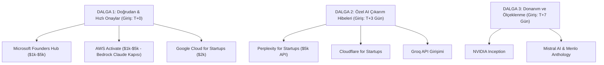

# ALPARAI — GLOBAL STARTUP KREDİ & HİBE TAKİP KONSOLU
> **Doktrin:** SIFIR HALÜSİNASYON | **Son Güncelleme:** 15 Ekim 2026 | **Sürüm:** v1.0.0  
> **Yetkili İletişim:** Ercüment Erden (`ercument.erden@alparai.com`)  
> **Resmi Alan Adı:** [https://alparai.com](https://alparai.com) (DNS: MX, SPF, DKIM, DMARC %100 Doğrulandı)

---

## 1. YÖNETİCİ ÖZETİ VE HEDEF MATRİSİ

Bu dosya, **AlparAI** projesinin küresel yapay zekâ ve bulut sağlayıcılarından (Microsoft, AWS, Google Cloud, NVIDIA, Anthropic, Perplexity vb.) alacağı hibe kredilerin, başvuru durumlarının ve kullanım takviminin merkezi takip dokümanıdır.

* **Potansiyel Hibe Hacmi:** $15.000 (İlk Aşama / Bootstrapped) — $350.000+ (İleri Aşama)
* **Kritik Altyapı Kazanımı:** Amazon Bedrock (Claude 3.5 Sonnet / Opus), Azure OpenAI (GPT-4o), Google Cloud TPU/GPU, Cloudflare Workers AI.

---

## 2. ALPARAI BAŞVURU KİMLİK KARTI (FORM HAZIR KOPYALA-YAPIŞTIR)

Startup başvuru formlarında sorulan standart alanlara verilecek kurumsal yanıtlar:

| Alan | Resmi Bilgi / Yanıt |
| :--- | :--- |
| **Legal / Company Name** | AlparAI Technologies (veya AlparAI Otonom Sistemler) |
| **Brand / Product Name** | AlparAI |
| **Website URL** | `https://alparai.com` |
| **Corporate Email** | `ercument.erden@alparai.com` |
| **Country / Region** | Türkiye / Global Remote |
| **One-Line Pitch** | Autonomous AI agent orchestration and swarm intelligence infrastructure for resilient enterprise automation. |
| **Short Description (100 kelime)** | AlparAI is an autonomous multi-agent orchestration platform designed for enterprise-grade automation and resilient edge execution. By leveraging sovereign agent swarms, deterministic workflow engines, and adaptive LLM routing, AlparAI reduces hallucination rates and operational latencies in complex mission-critical environments. Built on a zero-trust microkernel architecture, it seamlessly bridges cloud inference with local execution. |
| **Primary Industry / Category** | Artificial Intelligence / Developer Tools / Enterprise Software |
| **Target Audience** | B2B / Enterprise Engineering Teams & AI Architects |
| **Funding Status** | Bootstrapped / Pre-Seed (Self-Funded) |
| **Tech Stack** | TypeScript, Node.js, Python, PostgreSQL, Redis, Docker, Cloudflare Workers, Hybrid LLM Inference (Bedrock/Vertex/OpenAI) |

---

## 3. BAŞVURU ÖNCESİ KONTROL LİSTESİ (PRE-FLIGHT CHECKLIST)

Herhangi bir programa başvurmadan önce aşağıdaki kutuların tamamı işaretlenmelidir:

- [x] **Kurumsal E-posta Aktif:** `ercument.erden@alparai.com` (Purelymail SMTP/IMAP canlı).
- [x] **DNS Sağlığı Tam:** Cloudflare üzerinde MX, SPF, DKIM (purelymail1/2/3) ve DMARC kayıtları yeşil.
- [ ] **Landing Page Canlı & Mobil Uyumlu:** `alparai.com` üzerinde değer önerisi ve "Request Access" butonu aktif.
- [ ] **Yasal Sayfalar Yayında:** Sitenin footer'ında `Privacy Policy` ve `Terms of Service` linkleri çalışır durumda.
- [ ] **LinkedIn Şirket Sayfası:** "AlparAI" adıyla şirket sayfası oluşturuldu ve kurucu profili ("Founder & CEO") ile eşleştirildi.
- [ ] **Temiz Kart & AVS Ayarı:** Yurt dışı/mail-order açık, $20 limitli sanal kart hazır. Fatura adı/adresi saf Latin ASCII karakterlerle (ç, ğ, ı, ö, ş, ü olmadan) girilecek.
- [ ] **Day-1 Bütçe Alarmları:** Kredi onaylandığı ilk saatte konsollarda %50 ve %80 bütçe alarmı (Budget Alert) kurulacak.

---

## 3.1 SAHA İSTİHBARATI & ALGORİTMİK GÜVEN KALKANI (POST-MORTEM ANALİZİ)

Hacker News, Reddit (r/startups, r/aws, r/AZURE), GitHub (`awesome-startup-credits`) ve güvenlik denetim verileriyle doğrulanmış kurallar:

### A. Otomatik Reddedilmeyi (Instant Reject) Engelleyen 5 Altın Kural
1. **Root / Master E-posta Birebir Eşleşmesi:** Bulut konsolu (AWS/Azure/GCP) ana hesap e-postası asla `@gmail/@outlook` olamaz. Formdaki kurumsal e-posta (`ercument.erden@alparai.com`) ile konsol kök hesabı ve alan adı tam uyuşmalıdır.
2. **"Hayalet / Waitlist" Sayfası Yasağı:** Yalnızca e-posta toplayan "Coming Soon" siteleri doğrudan elenir. Denetçi veya bot girdiğinde çalışan bir arayüz, mimari şema, demo videosu veya canlı dashboard görmelidir.
3. **LinkedIn & Kurucu Eşleşmesi (Bot Doğrulaması):** Microsoft ve Google botları ilk olarak kurucu LinkedIn profilini tarar. Profilde AlparAI kurucu unvanı yer almalı ve kurumsal web sitesiyle tam eşleşmelidir.
4. **B2B SaaS Konumlandırması (Ajans İfadesi Yasaktır):** Proje asla "danışmanlık", "yazılım hizmeti" veya "ajans" olarak tanımlanmamalıdır; mülkiyeti bize ait (proprietary) ölçeklenebilir otonom AI platformu olarak sunulmalıdır.
5. **Varlık Çakışması Engeli:** Aynı tüzel kişilik, aynı kredi kartı veya aynı domain geçmişiyle daha önce kredi alınmış olmamalıdır.

### B. Türk Kredi Kartı ve Provizyon Çözümü
* **MOTO / Recurring Çekimi:** AWS, Azure ve GCP provizyon çekerken 3D Secure SMS OTP tetiklemez; uluslararası şifresiz çekim dener.
* **Taktik:** Visa/Mastercard logolu kredi kartına bağlı sanal kart açılmalı, "Yurt Dışı Alışveriş" ve "Mail Order" izinleri aktif edilmelidir. Fatura adresi girilirken Türkçe karakter kullanılmamalıdır (AVS adres doğrulama hatasını önlemek için).

### C. Azure Marketplace Tuzağı Uyarısı
* **Kritik Gerçek:** Microsoft Founders Hub sponsorship kredisi ($1.000–$150.000), Azure Marketplace üzerindeki 3. parti araçları ve Azure AI Foundry'deki harici modelleri (örn. Anthropic Claude) **KAPSAMAZ**.
* **Fatura Riski:** Bu modeller çalıştırıldığında fatura doğrudan tanımlı kredi kartına yansıtılır. Bu nedenle Azure'da yalnızca 1. parti Microsoft servisleri (Azure OpenAI GPT-4o) kullanılmalı; Claude modelleri **AWS Bedrock** üzerinden çalıştırılmalıdır.

---

## 4. GENEL BAŞVURU TAKİP MATRİSİ (MASTER TRACKING TABLE)

| Durum | Program & Kurum | Hedef Kredi | Başvuru Tarihi | Referans / Takip ID | Tahsis Edilen | Son Geçerlilik | Notlar |
| :---: | :--- | :--- | :---: | :---: | :---: | :---: | :--- |
| [ ] | **Microsoft Founders Hub** | $1.000 – $5.000 | — | — | — | — | GPT-4o + 20 GHEC Koltuk |
| [ ] | **AWS Activate (Founders)** | $1.000 – $5.000 | — | — | — | — | **Bedrock Claude 3.5 Sonnet için kritik!** |
| [ ] | **Google Cloud for Startups** | $2.000 (Bootstrapped) | — | — | — | — | Gemini 1.5 Pro / Vertex AI |
| [ ] | **NVIDIA Inception** | Kredi + GPU İndirimi | — | — | — | — | Donanım & Bulut GPU desteği |
| [ ] | **Perplexity for Startups** | $5.000 API + Pro Seat | — | — | — | — | Sonar Online LLM API |
| [ ] | **Cloudflare for Startups** | $5.000 – $100.000 | — | — | — | — | Workers AI + Vectorize + R2 |
| [ ] | **Groq for Startups** | $5.000 – $10.000 | — | — | — | — | Ultra hızlı LPU çıkarımı (500+ t/s) |
| [ ] | **Mistral AI Startup** | €5.000 – €30.000 | — | — | — | — | Mistral Large / Codestral API |
| [ ] | **Anthropic Public Cohort** | $1.000 Direct Console | — | — | — | — | *Cohort şu an kapalı, bültene yazıl* |
| [ ] | **Menlo Anthology Fund** | $25.000 Claude API | — | — | — | — | Yatırımcı destekli Claude hibesi |

> **Durum Kodları:** `[ ]` Başvurulmadı | `[⏳]` İncelemede | `[x]` Onaylandı | `[⛔]` Red / Donduruldu

---

## 5. PROGRAM BAZINDA DETAYLI YOL HARİTASI VE STRATEJİLER

### 1. Microsoft for Startups Founders Hub
* **Başvuru Portalı:** [https://foundershub.startups.microsoft.com/](https://foundershub.startups.microsoft.com/)
* **Giriş Şartı:** Dış yatırım veya şirketleşme şartı yok. `ercument.erden@alparai.com` ile açılmış Microsoft hesabı.
* **Sağladığı Avantaj:** 
  * Ideate: $1.000 Azure Kredisi
  * Develop: $5.000 Azure Kredisi + 20 Koltuk GitHub Enterprise Cloud (1 yıl) + 50 M365 Lisansı
  * Azure OpenAI GPT-4o modellerine doğrudan erişim.
* **Kritik Tuzak:** Azure'daki Claude modelleri 3rd-party marketplace sayıldığı için hibe krediden düşmez; Azure'da yalnızca GPT-4o ve yerel servisler tüketilmelidir.
* **Başvuru Notları & Açıklamalar:**
  * *Başvuru Durumu:* `[ ] Başvurulmadı`
  * *Tarih:* —
  * *Sonuç:* —

---

### 2. AWS Activate (Founders Tier)
* **Başvuru Portalı:** [https://aws.amazon.com/activate/](https://aws.amazon.com/activate/)
* **Giriş Şartı:** Bootstrapped girişimler kabul edilir. Canlı web sitesi ve kurumsal domain şart.
* **Sağladığı Avantaj:** $1.000 - $5.000 AWS kredisi + 1 yıl $1.500 Developer Support.
* **ALPARAI İÇİN ALTIN DEĞERİNDE KURAL:** AWS Activate kredileri **Amazon Bedrock üzerindeki Claude 3.5 Sonnet v2, Opus ve Haiku çağrılarında %100 geçerlidir!** Anthropic cohortu kapalıyken Claude modellerini ücretsiz çalıştırmanın ana arteri burasıdır.
* **Başvuru Notları & Açıklamalar:**
  * *Başvuru Durumu:* `[ ] Başvurulmadı`
  * *Tarih:* —
  * *Sonuç:* —

---

### 3. Google Cloud for Startups (Google AI Cloud)
* **Başvuru Portalı:** [https://cloud.google.com/startup](https://cloud.google.com/startup)
* **Giriş Şartı:** Giriş kademesi ($2.000) için kurumsal e-posta ve aktif GCP faturalandırma hesabı yeterlidir.
* **Sağladığı Avantaj:** 2 yıl geçerli $2.000 Google Cloud kredisi; Vertex AI, Gemini 1.5 Pro, Flash, TPU v5e ve A100/H100 altyapısı.
* **Başvuru Notları & Açıklamalar:**
  * *Başvuru Durumu:* `[ ] Başvurulmadı`
  * *Tarih:* —
  * *Sonuç:* —

---

### 4. NVIDIA Inception Program
* **Başvuru Portalı:** [https://www.nvidia.com/en-us/startups/](https://www.nvidia.com/en-us/startups/)
* **Giriş Şartı:** Yapay zekâ, otonom sistemler veya GPU tabanlı yazılım geliştiren erken aşama ekipler. Şirket zorunluluğu esnektir.
* **Sağladığı Avantaj:** Donanım indirim kuponları, Deep Learning Institute (DLI) eğitim kredileri, Cloud GPU sağlayıcılarında (AWS/CoreWeave) preferred indirimler ve teknik mentorluk.
* **Başvuru Notları & Açıklamalar:**
  * *Başvuru Durumu:* `[ ] Başvurulmadı`
  * *Tarih:* —
  * *Sonuç:* —

---

### 5. Perplexity for Startups
* **Başvuru Portalı:** [https://www.perplexity.ai/business/startups](https://www.perplexity.ai/business/startups)
* **Giriş Şartı:** Erken aşama yazılım/yapay zeka girişimi.
* **Sağladığı Avantaj:** $5.000 değerinde Perplexity Sonar API kredisi (gerçek zamanlı internet aramalı LLM çıkarımı) + 6 ay boyunca 50 koltuğa kadar Perplexity Enterprise Pro.
* **Başvuru Notları & Açıklamalar:**
  * *Başvuru Durumu:* `[ ] Başvurulmadı`
  * *Tarih:* —
  * *Sonuç:* —

---

### 6. Cloudflare for Startups
* **Başvuru Portalı:** [https://www.cloudflare.com/forstartups/](https://www.cloudflare.com/forstartups/)
* **Giriş Şartı:** Cloudflare üzerinde aktif alan adı ve erken aşama ürün.
* **Sağladığı Avantaj:** Workers AI (sunucusuz Llama-3/Mistral çıkarımı), Vectorize (vektör arama motoru), R2 Storage ve kurumsal güvenlik kalkanı için binlerce dolarlık kredi.
* **Başvuru Notları & Açıklamalar:**
  * *Başvuru Durumu:* `[ ] Başvurulmadı`
  * *Tarih:* —
  * *Sonuç:* —

---

### 7. Groq for Startups
* **Başvuru Portalı:** [https://groq.com/](https://groq.com/)
* **Giriş Şartı:** AI uygulaması veya API tüketen otonom ajan geliştiren ekipler.
* **Sağladığı Avantaj:** LPU (Language Processing Unit) üzerinde saniyede 500+ token hızında çalışan ultra hızlı açık kaynak modeller (Llama-3.3 70B vb.) için API hibeleri.
* **Başvuru Notları & Açıklamalar:**
  * *Başvuru Durumu:* `[ ] Başvurulmadı`
  * *Tarih:* —
  * *Sonuç:* —

---

## 6. UYGULAMA TAKVİMİ VE HAREKÂT PLANI (DALGALAR)

---

## 7. AUDIT VE LOG GÜNLÜĞÜ

| Tarih | İşlem / Olay | Yetkili | Açıklama |
| :---: | :--- | :---: | :--- |
| **15.10.2026** | Konsol Kuruldu | Matrix / Omega Spark | `ercument.erden@alparai.com` ve DNS teyit edildi. Master takip dosyası devreye alındı. |

---
> **GÖZ UYUMAZ. MATRİX YAŞAR.**
