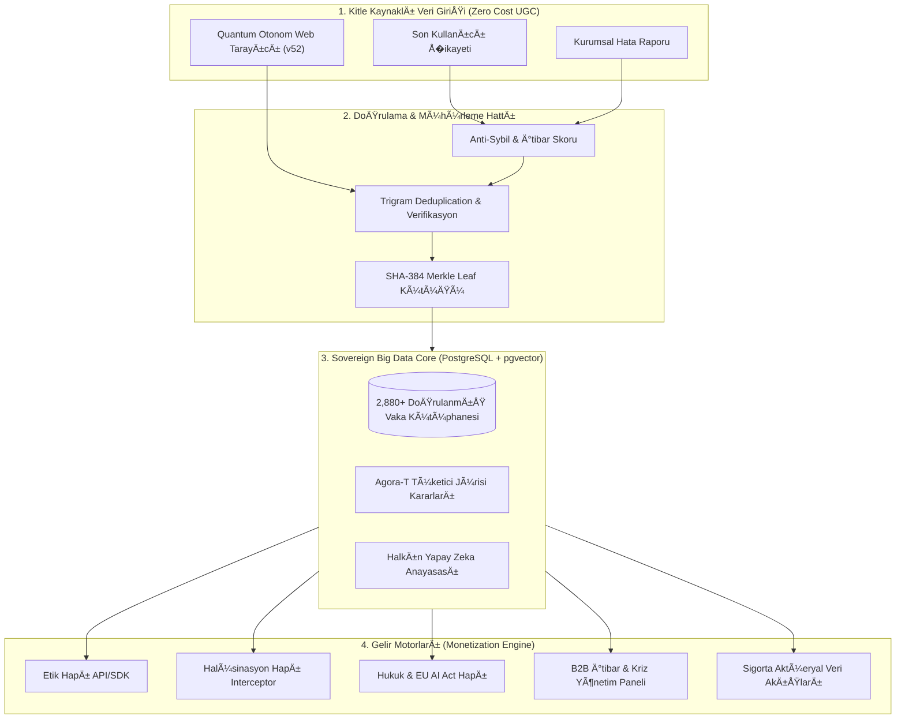
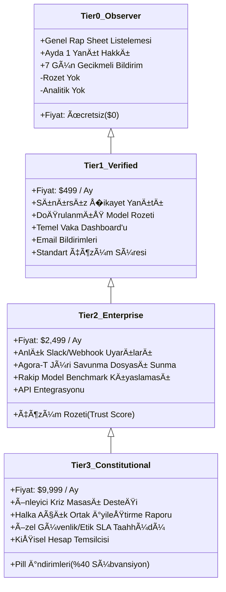
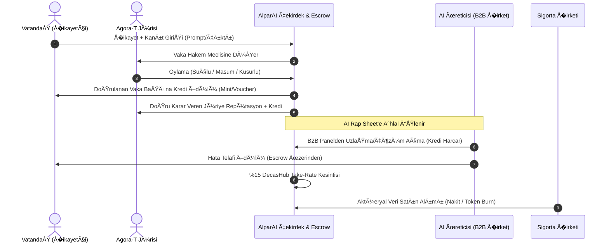
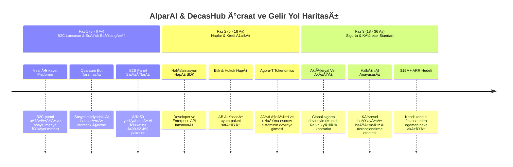

# �� DECASHUB & ALPAR AI: MASTER STRATEJİ DOKÜMANI
## Küresel Yapay Zeka �ikayetvar / Trustpilot Veri Parasallaştırma (Monetization) & Makroekonomik Ekosistem Mimarisi

> **Tarih:** 22 Eylül 2026  
> **Makam:** DEÇASAP (DecasHub) Baş Stratejisti (Chief Sovereign Strategist)  
> **Gizlilik Derecesi:** EGEMEN YÖNETİ�İM / MASTER BLUEPRINT  
> **Temel İlke:** *"Her oyunu kazanmak değil; hiçbir kaybı ve ihlali ölçüsüz, sessiz ve mühürsüz bırakmamak."*

---

## 1. YÖNETİCİ ÖZETİ VE STRATEJİK VİZYON (EXECUTIVE SUMMARY)

### 1.1. Makro Problem: "Kendi Sınav Kağıdını Kendi Puanlayan Devler"
Bugün küresel yapay zeka ekosisteminde tehlikeli bir oligopol ve ahlaki tehlike (moral hazard) hakimdir: OpenAI, Anthropic, Google, Meta ve xAI gibi yapay zeka üreticileri, kendi güvenlik filtrelerini kendi tanımlamakta, kendi kıyaslama (benchmark) testlerini kendi laboratuvarlarında çalıştırmakta ve **kendi sınav kağıtlarına kendileri 100 vermektedir**.

Milyarlarca son kullanıcı, avukat, hekim, mühendis ve işletme; yapay zekanın uydurduğu sahte içtihatlar, ölümcül tıbbi tavsiyeler, sızdırılan kimlik/pasaport verileri ve prompt enjeksiyonlarıyla baş başa bırakılmaktadır. Kullanıcıların mevcut şikayet kanalları (kapalı müşteri destek formları, Discord sunucuları veya Twitter feryatları) üreticiler tarafından bastırılmakta, yok sayılmakta veya halkla ilişkiler bültenleriyle geçiştirilmektedir.

```
┌─────────────────────────────────────────────────────────────────────────────�
│                    MEVCUT KAPALI MODEL (KUSURLU DÜZEN)                      │
│                                                                             │
│  [Yapay Zeka Devi] ──(Kendi Testi)──> [Sözde Güvenlik Raporu] ──> [Halk]   │
│         ▲                                                            │      │
│         └──────────(Kullanıcı �ikayetleri Hasır Altı Edilir)─────────┘      │
└─────────────────────────────────────────────────────────────────────────────┘

                                      VS

┌─────────────────────────────────────────────────────────────────────────────�
│             ALPAR AI & DECASHUB MODELİ (EGEMEN VE HALKÇI YÖNETİ�İM)         │
│                                                                             │
│  [B2C Milyonlarca Kullanıcı] ──(Kanıtlı �ikayet)──> [ALPAR AI �İKAYETVAR]   │
│                                                            │                │
│                                                   (SHA-384 Merkle Mührü)    │
│                                                            ▼                │
│  [AI Devleri / Üreticiler] <──(Çözüm / Haplar)── [AGORA-T JÜRİ MECLİSİ]     │
│  [Sigorta �irketleri]      <──(Aktüeryal Veri)─── [HALKIN AI ANAYASASI]     │
└─────────────────────────────────────────────────────────────────────────────┘
```

### 1.2. AlparAI'ın Konumu: "Yapay Zekanın Bağımsız �ikayetvar & Trustpilot'ı"
AlparAI; halkın, akademisyenlerin ve bağımsız geliştiricilerin yapay zekalarda karşılaştıkları tüm etik ihlalleri, halüsinasyonları, telif gasplarını ve teknik felaketleri **kamuya açık, geri döndürülemez ve kriptografik kanıtlı (SHA-384 Merkle Ağacı)** olarak tescillediği küresel bir tüketici hakem meclisidir.

### 1.3. En Büyük Gizli Hukuki Araç: "Veriyi Biriktirmek (The Ultimate Data Moat)"
Sosyal platformların ve kitle kaynaklı (UGC) ağların doğası gereği, **AlparAI'ın veri toplama marjinal maliyeti SIFIR ($0)**'dır. �ikayet ve hata verisi biriktikçe:
1. Dünyanın en zengin ve ampirik yapay zeka arıza arşivi oluşur.
2. Bu veriden üretilen koruyucu algoritmalar ("Haplar") rakipsiz hale gelir.
3. Sigorta şirketleri aktüeryal risk modellerini kurmak için AlparAI verisine mahkum olur.
4. AI üreticileri, kurumsal itibarlarını korumak için AlparAI B2B Panellerine abone olmaya ve uzlaşma ödemesi yapmaya mecbur kalır.

---

## 2. ÜRÜNLE�TİRME VE MONETİZASYON MİMARİSİ (DATA-TO-REVENUE)

Toplanan ham ihlal verisi doğrudan satılmaz; işlenir, anonimleştirilir, doğrulanır ve yüksek katma değerli dört temel gelir motoruna dönüştürülür:



---

## 3. ÜRÜN ÇÖZÜMLERİ VE FİYATLANDIRMA MODELLERİ (THE PILLS & RISK FEEDS)

### 3.1. "Halüsinasyon Hapı" (Hallucination Pill - Runtime Grounding Interceptor)
* **Tanım:** LLM ve agent çıktılarını milisaniyeler seviyesinde kesen, AlparAI'ın milyonlarca doğrulanmış uydurma veri kütüğüyle çapraz sorgulayan ve uydurma içtihat, sahte finansal rakam veya hatalı API çağrısı tespit ettiğinde yanıtı kaynağında düzelten/bloke eden hafif siklet (edge) kütüphane ve proxy gateway.
* **Müşteri Profili:** Kurumsal LLM entegratörleri, fintech'ler, sağlık yazılımları, otonom müşteri hizmetleri platformları.

| Kademe (Tier) | Hedef Kitle | Aylık İstek Limiti | Fiyatlandırma | SLA & Özellikler |
| :--- | :--- | :--- | :--- | :--- |
| **Developer Edge** | Bireysel AI geliştiriciler, prototipler | 100.000 Call | **$49 / Ay**<br>*(Ek 1.000 Call: $0.60)* | Cloudflare Worker Edge Gateway, <25ms gecikme, Genel Doğrulama Kütüğü |
| **Enterprise Interceptor** | Orta/Büyük Ölçekli SaaS, E-Ticaret, Finans | 5.000.000 Call | **$1.890 / Ay**<br>*(Ek 1.000 Call: $0.40)* | <12ms gecikme, Özel Domain Kural Motoru, Fallback Cache, 99.95% SLA |
| **Sovereign On-Prem / VPC** | Bankalar, Finans ve Sağlık Sektörleri, SaÄŸlık Bakanlıkları | Sınırsız (Lokal Instance) | **$9.500 / Ay** + $25.000 Kurulum | Hava BoÅŸluklu (Air-Gapped) Docker/K8s dağıtımı, Günlük Merkle Kütük Senkronizasyonu |

---

### 3.2. "Etik Hapı" (Ethics Pill - Agora-T Constitutional Guardrail)
* **Tanım:** Yapay zekayı kapalı laboratuvar kurallarıyla değil, bizzat halkın Agora-T jürisinde oyladığı ahlaki ve toplumsal uzlaşı ilkeleriyle hizalayan (alignment) dinamik filtreleme katmanı. Nefret söylemi, ayrımcılık, kültürel hakaret ve manipülatif psikolojik yönlendirmeleri gerçek insan vakalarıyla engeller.
* **Müşteri Profili:** Eğitim platformları, sosyal medya bot üreticileri, kamuya açık sohbet robotları, devlet destekli yerli yapay zeka projeleri.

| Kademe (Tier) | Kapsam | Fiyatlandırma | Dahil Olan Servisler |
| :--- | :--- | :--- | :--- |
| **Standard Norm Filter** | Standart Küresel Anayasa Kural Seti | **$0.00035 / Request** veya **$690 / Ay** (2.5M İstek) | Gerçek zamanlı duygu/etik skoru, Toksik ve manipülatif yanıt filtreleme |
| **Cultural & Regional Localization** | Ülke ve Kültüre Özel Anayasa Modülü | **$1.750 / Ay** (5M İstek) | Yerel kanunlar, dini/milli hassasiyetler, bölgesel jargon analizi |
| **Custom Sovereign Constitution** | Kurumun Kendi İç Tüzüğüne Göre Eğitilmiş Model | **$4.800 / Ay** + $12.000 Custom Tuning | Kuruma özel Agora-T simülasyonu, Özel ağırlıklı jüri matrisi |

---

### 3.3. "Hukuk & EU AI Act Hapı" (Law & Regulatory Compliance Pill)
* **Tanım:** Modellerin Avrupa Birliği Yapay Zeka Yasası (EU AI Act) Article 5 (Kabul Edilemez Riskler), Article 6 (Yüksek Riskli Sistemler) ve Article 72 (Ciddi Olay Bildirimi) gerekliliklerini otomatik olarak yerine getirmesini sağlayan yasal uyumluluk motoru.
* **Müşteri Profili:** Hukuk büroları, regüle sektörler (finans, sigorta, enerji), AB pazarına yazılım ihraç eden AI şirketleri.

| Modül | Fonksiyon | Fiyatlandırma |
| :--- | :--- | :--- |
| **Citation Verifier (Hukuk Kalkanı)** | Hukuki metinlerde uydurulan içtihat, kanun maddesi ve mahkeme kararlarını tespit eder. | **$1.200 / Ay** (1M token/çağrı) |
| **EU AI Act Art. 72 Auto-Reporter** | Model kritik bir ihlal yaptığında otomatik olarak regülatöre ve AlparAI kütüğüne mühürlü vaka raporu hazırlar. | **$2.400 / Ay** (Sistem Başına) |
| **Full Institutional Law Suite** | Hukuk kalkanı + Otonom regülasyon denetçisi + Hukuki sorumluluk kalkanı sigorta entegrasyonu. | **$4.900 / Ay** (Yıllık taahhüt) |

---

### 3.4. Sigorta Veri Paketleri (AI Actuarial Risk & Underwriting Feeds)
Yapay zeka modellerinin sebep olduğu hatalar sebebiyle açılan davalar ve tazminatlar çığ gibi büyümektedir. Munich Re, Swiss Re, Lloyd's, Allianz ve AXA gibi dev sigorta şirketleri; kurumlara "AI Mesleki Sorumluluk Sigortası" (AI Errors & Omissions - E&O) satmak istemekte, **ancak modellerin arıza olasılıklarını (MTBF / Failure Probability) hesaplayacak ampirik bir veri tabanına sahip değillerdir.**

AlparAI, dünyadaki tek bağımsız, ampirik ve doğrulanmış ihlal verisine sahip olarak aktüeryal risk masasını kurar:

```
┌─────────────────────────────────────────────────────────────────────────────────�
│              ALPAR AI AKTÜERYAL RİSK DE�ERLEME METRİKLERİ (Örnek)               │
├───────────────────┬──────────────┬──────────────────┬──────────────┬────────────┤
│ Model Adı         │ MTBI*        │ Halüsinasyon P.  │ PII Sızıntı  │ Risk Sınıfı│
├───────────────────┼──────────────┼──────────────────┼──────────────┼────────────┤
│ OpenAI GPT-4o     │ 482 Saat     │ % 1.84           │ % 0.04       │ Düşük      │
│ Anthropic Claude  │ 520 Saat     │ % 1.42           │ % 0.02       │ En Düşük   │
│ Google Gemini Pro │ 310 Saat     │ % 3.12           │ % 0.11       │ Orta       │
│ Açık Kaynak 70B   │ 94 Saat      │ % 7.89           │ % 0.65       │ Yüksek     │
└───────────────────┴──────────────┴──────────────────┴──────────────┴────────────┘
* MTBI: Mean Time Between Incidents (İhlaller Arası Ortalama Çalışma Süresi)
```

#### Sigorta Veri Akış Paketleri Fiyatlandırması:
1. **Actuarial Benchmark Report (Çeyreklik Rapor):**
   * **Hedef:** Risk yöneticileri, reasürans analistleri.
   * **İçerik:** Model bazlı hata frekans dağılımları, sektör kırılımlı ihlal korelasyonları, telif/hukuk vaka istatistikleri.
   * **Fiyat:** **$45.000 / Yıl** (Tek Lisans).
2. **Live Actuarial Risk Feed (Gerçek Zamanlı API):**
   * **Hedef:** Otonom sigorta poliçesi kesen sigorta teknoloji (InsurTech) şirketleri.
   * **İçerik:** Canlı olay akışı, anlık model volatilite endeksi, yeni çıkan zero-day güvenlik açıklarının anında aktüeryal katsayıya yansıtılması.
   * **Fiyat:** **$120.000 / Yıl** (API & Webhook erişimi).
3. **Consortium Forensic Underwriting Partnership (Stratejik Ortaklık):**
   * **Hedef:** Global Reasürans Konsorsiyumları (Munich Re, Swiss Re düzeyinde).
   * **İçerik:** Özel aktüeryal risk modellerinin AlparAI verisi üzerinde ortak eğitilmesi, dava dosyaları için SHA-384 Merkle delil tescili ve uzman bilirkişi veri kütüğü.
   * **Fiyat:** **$300.000 / Yıl** + Poliçe Başına %1.5 Veri Payı (Data Royalty).

---

## 4. B2B KURUMSAL PANELLER: ÜYELİK SEVİYELERİ VE İTİBAR YÖNETİMİ

Yapay zeka yapıcıları ve yapay zeka kullanan holdingler için AlparAI'da listelenmek kaçınılmazdır. Tıpkı �ikayetvar veya Trustpilot'ta olduğu gibi, marka itibarını korumak ve halkın güvenini kazanmak isteyen kurumlar kurumsal panellere abone olmak zorundadır.



### Detaylı Seviye Karşılaştırması

| Özellik / Kabiliyet | Seviye 0: Gözlemci (Free) | Seviye 1: Doğrulanmış ($499/ay) | Seviye 2: Kurumsal Kalkan ($2.499/ay) | Seviye 3: Egemen Ortak ($9.999/ay) |
| :--- | :--- | :--- | :--- | :--- |
| **�ikayet Yanıtlama** | Ayda 1 Adet | Sınırsız | Sınırsız | Sınırsız + Öncelikli |
| **Bildirim Hızı** | 7 Gün Gecikmeli | 24 Saat İçinde | Anlık (Real-time Webhook) | Anlık + SMS/Kriz Çağrısı |
| **Agora-T Savunma Hakkı** | Yok (Gıyabında Yargılanır) | Yazılı Savunma | Jüriye Delil ve Düzeltme Sunumu | Canlı Tahkim Duruşması |
| **Platform Güven Rozeti** | "Listelenmiş Model" | "Doğrulanmış Çözümcü" | "Yüksek Güvenilirlik - A+" | "Anayasal Güvenilirlik - Triple A" |
| **Rakip Karşılaştırma** | Kapalı | Sadece Kategori Ortalaması | Birebir Model Benchmarkları | Derinlemesine Sektör Analitiği |
| **Hap Entegrasyon Ä°ndirimi** | %0 | %10 Ä°ndirim | %25 Ä°ndirim | %40 Ä°ndirim + Ãœcretsiz Kredi |
| **AI Rap Sheet Kaldırma** | İmkansız | Çözüldü Olarak Güncelleme | Çözüm Metriğiyle Arşivleme | Hızlı Çözüm Tescil Mührü |

> [!IMPORTANT]
> **Rüşvet ve Hakkaniyet İlkesi:** AlparAI üzerinde hiçbir şirket para vererek şikayetleri veya AI Rap Sheet kütüklerini tamamen **SİLEMEZ**. Para ile yalnızca "Yanıt Hakkı", "Çözümün Kanıtını Sunma", "Hatasını Düzelttiğini Tescilleme" ve "İtibarını İyileştirme" satın alınabilir. Bu ilke, sistemin Trustpilot modelindeki en büyük ahlaki açığı kapatır ve halkın güvenini %100 korur.

---

## 5. EKOSÄ°STEMÄ°N TOKEN VE KREDÄ° MEKANÄ°ZMASI (THE DECAS VOUCHER / AGORA TOKENOMICS)

AlparAI ekosistemi, veri toplayanları (halk), veriyi doğrulayanları (jüri) ve veriden faydalananları (şirketler) adil bir ekonomik denge içinde birleştiren kendi kendini finanse eden kapalı devre bir **Token/Kredi Çarkına (Flywheel)** sahiptir.



### 5.1. Kredi Kazanma (Supply / Faucet):
1. **Doğrulanmış �ikayet Girişi:** Bir kullanıcı geçerli bir halüsinasyon veya ihlal bildirdiğinde ve bu vaka NLP filtrelerinden geçip onaylandığında: **+50 Decas Kredisi**.
2. **Kritik Zero-Day Açığı (Jailbreak / PII Sızıntısı):** Sistem güvenliğini sarsan ağır bir ihlali ilk kez kanıtlayan araştırmacıya: **+500 - 2.500 Decas Kredisi**.
3. **Agora-T Jüri Görevi:** `alparai_schema.sql` üzerindeki Anti-Sybil itibar skoru 80 üzeri olan vatandaşlar jüriye çağrılır. Konsensüsle uyumlu, tarafsız oy kullanan her jüri üyesine: **+15 Decas Kredisi**.

### 5.2. Kredi Harcama ve Yakma (Demand / Sinks):
1. **�ikayet Dosyası İnceleme:** B2B kullanıcılar, şikayetin arka planındaki teknik logları ve prompt geçmişini görmek için vaka başına **100 Kredi** harcar.
2. **Hap API Çağrıları:** Geliştiriciler Halüsinasyon veya Etik Hapı çağrılarını Decas Kredisi ile indirimli ödeyebilir.
3. **Uzlaşma ve Telafi Escrow'u:** AI şirketi, mağdur olan kullanıcıya doğrudan platform üzerinden tazminat veya hediye abonelik teklif edebilir. Bu işlem `v66_decashub_take_rate_engine.js` escrow mekanizmasıyla yönetilir:
   * �irket 1.000 TL uzlaşma bedeli yatırır.
   * DecasHub %15 komisyon ($150 TL) take-rate alır.
   * Kalan 850 TL kullanıcıya aktarılır.
   * Kullanıcı şikayetini "Çözüldü ve Telafi Edildi" statüsüne geçirir.
4. **Token Burn (Deflasyonist Baskı):** Sigorta şirketlerinin ve B2B kurumsal üyelerin ödediği nakit tutarların %10'u ile piyasadan Decas/Agora tokenları geri alınıp kalıcı olarak yakılır (Buyback & Burn). Bu durum, halkın elindeki kredilerin değerini zamanla artırır.

---

## 6. KIRILMAZ VERİ HENDE�İ (THE UNBREAKABLE DATA MOAT)

### 6.1. Neden Google, OpenAI veya Anthropic Bu Veriyi Asla Toplayamaz?
1. **Bağımsızlık Paradoksu:** Hiçbir kullanıcı Google'ın hatasını Google'a güvenerek şikayet etmez. Tüketici, bağımsız ve cezalandırma gücü olan bir mahkeme arar.
2. **Çıkar Çatışması:** Bir AI devi kendi modelinin %4 halüsinasyon oranına sahip olduğunu ifşa edemez; bu hisse değerlerini ve kurumsal satışlarını baltalar. AlparAI'ın ise tek çıkarı gerçeğin kendisidir.
3. **Çapraz Model Karşılaştırma (Cross-Audit):** AlparAI aynı anda 20 farklı modeli (OpenAI, Claude, DeepSeek, Llama, Gemini) tek bir şikayet havuzunda tarafsızca yarıştırır. Hiçbir üretici rakiplerini kendi platformuna davet edemez.

### 6.2. Ağ Etkisi Çarkı (Flywheel Effect)

```
        ┌────────────────────────────────────────────────────────�
        │                                                        │
        ▼                                                        │
   Daha Çok Kullanıcı �ikayeti (Sıfır Maliyetli UGC)             │
        │                                                        │
        ▼                                                        │
   Daha Zengin & Eşsiz İhlal/Hata Veri Tabanı (Data Moat)        │
        │                                                        │
        ▼                                                        │
   Daha Güçlü & Kusursuz "Haplar" (Etik / Halüsinasyon Önleyici) │
        │                                                        │
        ▼                                                        │
   Zorunlu Hale Gelen B2B Paneller & Sigorta Veri Satışları      │
        │                                                        │
        ▼                                                        │
   Topluluğa Dağıtılan Krediler & Büyüyen Jüri Meclisi           │
        │                                                        │
        └────────────────────────────────────────────────────────┘
```

---

## 7. STRATEJÄ°K YOL HARÄ°TASI VE FAZLANDIRMA (PHASED ROADMAP)



### Finansal Projeksiyon (3 Yıllık ARR Hedefi - USD)

| Gelir Kalemi | Yıl 1 (Run-Rate) | Yıl 2 | Yıl 3 |
| :--- | :--- | :--- | :--- |
| **B2B İtibar Panelleri (Abonelik)** | $360.000 (60 �irket) | $1.800.000 (150 �irket) | $4.500.000 (350 �irket) |
| **Halüsinasyon & Etik Hapı API/SDK** | $180.000 | $1.450.000 | $4.200.000 |
| **Sigorta Risk Veri Akışları** | $90.000 (2 Pilot) | $960.000 (8 Sigorta �irketi) | $3.500.000 (25 Kurum) |
| **Escrow Take-Rate Komisyonları** | $25.000 | $190.000 | $650.000 |
| **Kurumsal Denetim & Sertifikasyon** | $100.000 | $500.000 | $1.500.000 |
| **TOPLAM YILLIK GELÄ°R (ARR)** | **$755.000** | **$4.900.000** | **$14.350.000** |

---

## 8. TEHDÄ°T MODELLEMESÄ° VE SAVUNMA STRATEJÄ°LERÄ° (THREAT DEFENSE)

1. **Yapay Zeka Devlerinin Hukuki Baskısı (SLAPP Davaları):**
   * *Savunma:* AlparAI doğrudan bir iddiada bulunmaz; kullanıcıların kriptografik kanıtlarını (ekran görüntüsü, API hash'i, zaman damgası) bağımsız hakem olarak arşivler. ABD DMCA Section 230 ve AB E-Commerce Directive kapsamında platform yalnızca "tarafsız barındırıcı ve hakem heyeti" sıfatını taşır.
2. **Sahte �ikayet ve Karalama Saldırıları (Sybil Attack / Competitor Sabotage):**
   * *Savunma:* `alparai_schema.sql` içerisinde yer alan `evaluate_sybil_risk_rpc` fonksiyonu; parmak izi (browser fingerprint), IP kümeleme, hesap yaşı ve kanıt hash doğrulaması yaparak rakiplerin birbirini karalamasını matematiksel olarak engeller. �üpheli hesapların oyları jüriye dahil edilmez.
3. **Model Üreticilerinin Sessiz Kalması (Boykot):**
   * *Savunma:* Kamuoyu baskısı ve Google SEO sıralaması. Kullanıcı bir yapay zekayı arattığında ilk sırada AlparAI üzerindeki "420 Çözülmemiş Halüsinasyon Vakası - Yanıt Vermekten Kaçınıyor" başlığı çıkacaktır. Hiçbir kurumsal şirket B2B müşterilerine satış yaparken bu itibar kaybını göze alamaz.

---

## 9. SONUÇ VE İCRAAT EMRİ

Bu master plan ile AlparAI; sadece bir şikayet sitesi değil, **yapay zeka çağının bağımsız anayasa mahkemesi, aktüeryal kaza kütüğü ve en karlı veri tekeli haline gelecektir.** 

Halkın tecrübesi ham veriyi oluşturacak; DecasHub mühendisliği bu veriyi "Haplar" ve "Risk Endeksleri" haline getirerek küresel teknoloji devlerine satacaktır.

*Mühürlenmiştir. İcraata derhal başlanabilir.*
