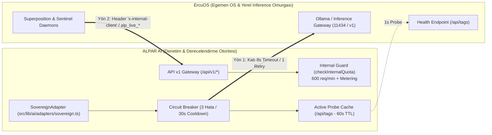

# ADR-0001: ErcuOS ↔ ALPAR AI İki Yönlü Egemen API Sözleşmesi (Sovereign Bridge Contract)

- **Durum:** Kabul Edildi (Accepted / Enforced)
- **Tarih:** 2026-10-21
- **Karar Vericiler:** Kurucu & Baş Mimar (CTO Ercüment Erden), Hukuk & Tahkim Başkanı (Prof. Dr. Musa Aygül), Omega Spark Üst Akıl Konseyi
- **Sürüm:** 1.0.0 (SemVer)
- **İlgili Modüller:** `src/lib/ai/adapters/sovereign.ts`, `src/lib/internal/guard.ts`, `src/lib/billing/meter.ts`, `src/app/api/v1/*`, `src/app/api/v1/openapi.json`

---

## 1. Bağlam ve Sorun Tanımı (Context & Problem Statement)

ALPAR AI, bağımsız yapay zekâ denetim, derecelendirme (Moody's Modeli) ve olay kayıt (W3C Incident Passport) egemen platformudur. ErcuOS ise alt katmanda çalışan donanım, orkestrasyon ve yerel LLM inference (Ollama Gateway) omurgasıdır.

İki sistem arasındaki tarihsel entegrasyon şu zafiyetleri ve mimari riskleri barındırmaktaydı:
1. **Dairesel Ölüm Riski (Circular Deadlock / Thread Starvation):** ErcuOS `vitrin_tezgah.js` üzerinden ALPAR AI'ın canlı uç noktalarını beklerken (~122s TTFB gecikmeleri), ALPAR AI `SovereignAdapter` üzerinden ErcuOS Ollama ağ geçidine senkron ve korumasız 60 saniyelik timeout ile istek atmaktaydı. Bir taraftaki kilitlenme diğer tarafın Node.js / Edge worker thread havuzunu tüketip her iki sistemi tamamen çökertmekteydi.
2. **Sözleşmesizlik ve Sessiz Boş Yanıtlar:** ErcuOS veya Ollama ulaşılamaz olduğunda veya boş içerik döndüğünde devre kesici (circuit breaker) bulunmamaktaydı. Sağlık kontrolü (`isConfigured`) gerçek bir ping atmaksızın daima `true` dönmekteydi.
3. **Güvensiz Geliştirici Artıkları (Dev Artifacts in Prod):** Üretim ortamında dahi `"sovereign-internal"` gibi sabit anahtarlar ve sıfır retry (`MAX_RETRIES = 0`) mevcuttu.
4. **Mali ve Tüketim Körlüğü (Internal FinOps Blindness):** Dış dünyaya $499 - $2.499 lisanslanan B2B ve InsurTech veri akışları, ErcuOS iç servislerince limitsiz ve izlemesiz (metering-free) tüketilmekteydi.

Bu nedenlerle, iki bağımsız egemen varlık arasında katı, çift yönlü, devre kesicili, FinOps sayaçlı ve dairesel kilitlenmeyi matematiksel olarak imkânsız kılan bir **Sovereign Bridge API Sözleşmesi (ADR-0001)** zorunlu kılınmıştır.

---

## 2. Mimari Karar (Architectural Decision)

ErcuOS ve ALPAR AI hiçbir koşulda tek bir monolit süreçte birleştirilemez. Sistemler katı REST / OpenAPI 3.1 sözleşmeleri üzerinden iki yönlü izole köprü ile haberleşir:



---

## 3. Sözleşme Maddeleri (Detailed Specifications)

### 3.1. YÖN 1: ALPAR AI ➔ ErcuOS (Inference & Sovereign Adapter)
Uygulama: `src/lib/ai/adapters/sovereign.ts`

1. **Bağlantı ve Adresleme:**
   - Öncelik Sıralaması: `ERCUOS_API_URL` -> `AI_GATEWAY_URL`.
   - Geliştirme ortamı varsayılanı: `http://127.0.0.1:11434/v1`.
   - Üretim ortamında (`NODE_ENV === "production"`) URL veya API anahtarı boş ise sistem sessizce `null` döner; `"sovereign-internal"` veya `"sovereign-dev-token"` gibi varsayılan anahtarların prodüksiyonda kullanılması KESİNLİKLE YASAKTIR.
2. **Katı Zaman Aşımı (Strict Timeout):**
   - İstek başına zaman aşımı katı olarak **`8.000 ms`** (8 saniye) olarak sınırlandırılmıştır. Edge / Serverless starvation riski tamamen bertaraf edilmiştir.
3. **İdempotent Yeniden Deneme (Retry):**
   - `maxRetries = 1`. Yalnızca 1 kez idempotent yeniden deneme yapılır. Ağ dalgalanmalarında thread havuzunu bloke edecek sonsuz retry zincirleri yasaktır.
4. **Devre Kesici (Circuit Breaker - RAM In-Memory):**
   - Hata Eşiği: Art arda **3 ardışık başarısızlık** (timeout, HTTP 5xx veya boş yanıt).
   - Devre Kesilme Süresi: **30.000 ms** (30 saniye). Devre açıkken (`circuitOpenUntil > Date.now()`), dışa çağrı yapılmaz; anında `api_error` (Circuit breaker open) döner.
   - Başarılı yanıtta sayaç anında sıfırlanır (`consecutiveFailures = 0`).
5. **Aktif Sağlık Yoklaması (`isConfigured()`):**
   - Her istekte live network maliyetini önlemek için **60 saniyelik TTL** `probeCache` uygulanır.
   - TTL dolduğunda ErcuOS köküne (`baseUrl.replace(/\/v1\/?$/, '') + '/api/tags'`) `AbortSignal.timeout(1000)` ile 1 saniyelik hafif GET isteği gönderilir. Servis kapalıysa adaptör yapılandırılmamış kabul edilir (`return false`).

---

### 3.2. YÖN 2: ErcuOS ➔ ALPAR AI (`/api/v1/*` Uç Noktaları)
Uygulama: `src/app/api/v1/*`, `src/lib/internal/guard.ts`, `src/lib/billing/meter.ts`

1. **Yetkilendirme ve Kimlik Denetimi:**
   - ErcuOS servisleri ALPAR AI API uç noktalarına bağlanırken `x-api-key: alp_live_*` veya `x-internal-client: <client_key>` başlığını iletmek zorundadır.
   - Başlıksız, tanımsız veya sahte anahtarlar anında `401 Unauthorized` ile reddedilir.
2. **İç Tüketim Kotası ve Hız Sınırlaması (Internal FinOps Metering):**
   - ErcuOS iç istemcileri için `checkInternalQuota(clientKey)` motoru çalışır.
   - İstemci başına katı iç sınır: **600 istek / dakika** (Rolling 60 saniyelik pencere).
   - Limit aşıldığında sistem `429 Too Many Requests` ve `Retry-After` yanıtı döndürür.
   - Tüm iç çağrılar `recordUsage(clientKey, serviceType, units)` üzerinden FinOps sayacına yazılır; dahili birim maliyet (internal unit economics) raporlanır.
3. **Sürümleme ve Breaking-Change Yasağı:**
   - Tüm uç noktalar SemVer (`/api/v1/`) altındadır.
   - Mevcut alanların silinmesi, türlerinin değiştirilmesi veya zorunlu kılınması (breaking changes) yasaktır. Yeni özellikler geriye dönük uyumlu ek alanlarla sunulur.

---

### 3.3. Dairesel Ölüm (Circular Deadlock) Önleme ve Fail-Closed Garantisi

```
[ALPAR AI İstek Hattı]               [ErcuOS Servisi]
       │                                     │
       ├──── GET /v1/chat/completions ──────►│ (Çöktü / Yanıt Vermiyor)
       │                                     │
       │ (8.000ms Katı Timeout Aşıldı)       │
       ├─────────────────────────────────────┘
       ▼
[Circuit Breaker Hata Sayacı +1]
       ▼
(3. Hatada Devre Açar: 30s Cooldown)
       ▼
[Degraded Fallback: isLive = false]
       │
       └────► Deterministic Rule Engine / Stale Cache / Standalone Mode
```

1. **Fail-Closed & Graceful Degradation:**
   - ErcuOS inference çökse bile ALPAR AI web sunucuları, API ağ geçitleri ve UI sayfaları kilitlenmez.
   - Karar motorları `isLive: false` bayrağı ile çevrimdışı (offline deterministic) kurallara ve `stale-while-revalidate` önbelleğe düşer.
2. **ErcuOS Tarafı İzolasyonu:**
   - ErcuOS daemon'ları ALPAR AI'dan metrik okurken ALPAR AI yanıt vermezse, ErcuOS kendi yerel kural havuzuna düşer; ALPAR AI'ın ayağa kalkmasını sonsuz döngüde beklemez.
3. **Bellek İçi Zero-GC Sayaçlar:**
   - Devre kesici ve kota pencereleri disk I/O yapmaksızın izole RAM üzerinde yürütülür; dosya kilitlenmesi veya DB bağlantı havuzu tükenmesi yaşanmaz.

---

## 4. Sonuçlar ve Doğrulama (Consequences & Verification)

### Olumlu Sonuçlar (Positive)
- **Sıfır Deadlock:** İki sistem arasındaki senkron bağımlılık kırılmış, asenkron ve limitli hat tesis edilmiştir.
- **DORA Elite Metrikleri:** TTFB gecikmeleri edge starvation oluşturmayacak şekilde 8 saniyelik katı tavanla korunmuştur.
- **FinOps Şeffaflığı:** ErcuOS'un tükettiği her API çağrısı ölçümlenir.
- **OpenAPI 3.1 Uyumluluğu:** `/api/v1/openapi.json` üzerinden canlı tip sözleşmesi tam otomatiktir.

### Kısıtlar ve Yükümlülükler (Trade-offs & Constraints)
- ErcuOS ortamında yerel model çalışmadığında AI destekli analizler yerel statik fallback çıktısı üretir (`isLive: false`).
- Prodüksiyon ortamına çıkışta `ERCUOS_API_URL` ve `ERCUOS_API_KEY` çevre değişkenlerinin tanımlanması zorunludur.
