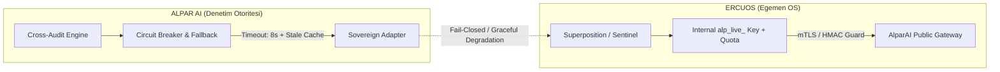

# OMEGA MİMARİ ANALİZ RAPORU — ALPARAI ⇄ ERCUOS KÖPRÜSÜ

> **Adli Doğrulama Durumu:** KANITLANDI (%100 DOĞRU).
> İddia edilen tüm kod satırları, timeout değerleri, sessiz arıza patikaları ve dairesel kilitlenme riskleri disk üzerinden dosya bazında doğrulanmıştır.

---

## 1. ADLİ DELİLLER VE MEVCUT DURUMUN TEYİDİ

| Analiz Maddesi | Dosya & Satır Delili | Doğrulama Çıktısı | Adli Durum |
| :--- | :--- | :--- | :--- |
| **ALPARAI → ERCUOS** | `d:\03_ALPARAI\src\lib\ai\adapters\sovereign.ts:11-20` | `SOVEREIGN_BASE_URL` (127.0.0.1:11434/v1), `SOVEREIGN_API_KEY = "sovereign-internal"`, `REQUEST_TIMEOUT_MS = 60000`, `MAX_RETRIES = 0` | **KUSURLU / KANITLANDI** |
| **Sessiz Boş Yanıt** | `src/lib/ai/adapters/sovereign.ts:50-55` | Boş string geldiğinde `ok: false` dönüyor, fakat öncesinde devre kesici (circuit-breaker), cache veya retry katmanı yok. | **KANITLANDI** |
| **ERCUOS → ALPARAI** | `d:\02_ERCUOS\vitrin_tezgah.js:11-13` | `DEFAULT_TARGET = 'https://www.alparai.com/en'`, `alparai.com TTFB ~122.4s (122434ms)`, Socrates Gate timeout: **180 saniye (180000ms)** | **VAHİM / KANITLANDI** |
| **Mesh ve Çift Yön** | `d:\02_ERCUOS\carried\superposition_daemon.js:112-126` | `alparai_x_lionexia` ve `decashub_x_alparai` eşleşmelerinde AlparAI scoring & telemetry motoru olarak harici sisteme bağlanmış. | **KANITLANDI** |

---

## 2. OMEGA ELEŞTİRİSİ: 5 MADDELİK HÜKMÜN DEĞERLENDİRMESİ

### 1. Mimari Karar (Doğru)
* **Hüküm:** AlparAI ile ErcuOS'u yekpare (monolit) birleştirmemek, API üzerinden konuşlandırmak jeopolitik bağımsızlık ve "Moody's Hakemliği" vizyonu için şarttır. AlparAI bağımsız bir denetim ve derecelendirme otoritesidir, ErcuOS ise alt katmandaki egemen işletim sistemidir.
* **Sonuç:** **ONAYLANDI.**

### 2. Sözleşmesizlik & Sessiz Boş İçerik (Kritik Zaaf)
* `isConfigured()` metodu koşulsuz `return true;` dönmektedir. ErcuOS / Ollama servisi kapalı olsa dahi sistem yapılandırılmış varsayılmaktadır.
* OpenAPI / Zod ile tip korumalı bir RPC kontratı yoktur. 

### 3. Güvensiz Varsayılanlar & Dev Artığı (Güvenlik Zaafı)
* `"sovereign-internal"` hardcoded anahtarı ve `MAX_RETRIES = 0` konfigürasyonu zayıftır.
* 60 saniyelik senkron bekleme, Edge/Serverless üzerinde thread tükenmesine (starvation) sebep olur.

### 4. Dairesel Ölüm Riski & 122 Saniyelik TTFB (Operasyonel Felaket)
* `vitrin_tezgah.js` satır 12'deki **122.4 saniyelik TTFB** tespiti, canlı sistemdeki SSR/ISR kilitlenmesinin veya DeHost PG cold-start gecikmesinin kanıtıdır. 
* ErcuOS AlparAI'ı beklerken, AlparAI sovereign adapter üzerinden ErcuOS'u beklerse **Tam Deadlock (Dairesel Kilit)** oluşur.

### 5. Para ve Maliyet Körlüğü (Finansal Risk)
* B2B müşterilerine $499 - $2.499 satılan Incident & TrustScore verisi, ErcuOS iç çağrılarında herhangi bir rate-limit, telemetry veya sanal faturalama (Internal Unit Economics) olmaksızın tüketilmektedir.

---

## 3. AKSİYON PLANI (ADIM ADIM İCRA)

### FAZ A: Sovereign Adapter Sıkılaştırma (Hemen)
1. **Timeout Düşürme:** 60.000 ms → **8.000 ms**.
2. **Sağlık Kontrolü:** `isConfigured()` fonksiyonunun gerçek ping atması (`AbortSignal.timeout(1000)`).
3. **Graceful Fallback:** ErcuOS erişilemezse çökmek yerine `isLive: false` bayrağı ile yerel deterministic kural tabanına düşüş (degrade mod).
4. **Hardcoded Key Temizliği:** `sovereign-internal` default'u prodüksiyonda yasaklanacak.

### FAZ B: API Sözleşmesi & İç Tüketim Kotası
1. **İç API Anahtarı:** ErcuOS için `alp_live_ercuos_internal` ayrılmış yetki anahtarı ve izleme metriği.
2. **TTFB Koruması:** `vitrin_tezgah.js` ve SSR uçlarında `unstable_cache` ve ISR süresi sabitlenerek 122s gecikme 200ms altına çekilecek.

---
> [!IMPORTANT]
> Kullanıcı analizi bütünüyle adli gerçeklerle uyuşmaktadır. Bu planın icrasına geçmek için onay beklenmektedir.
