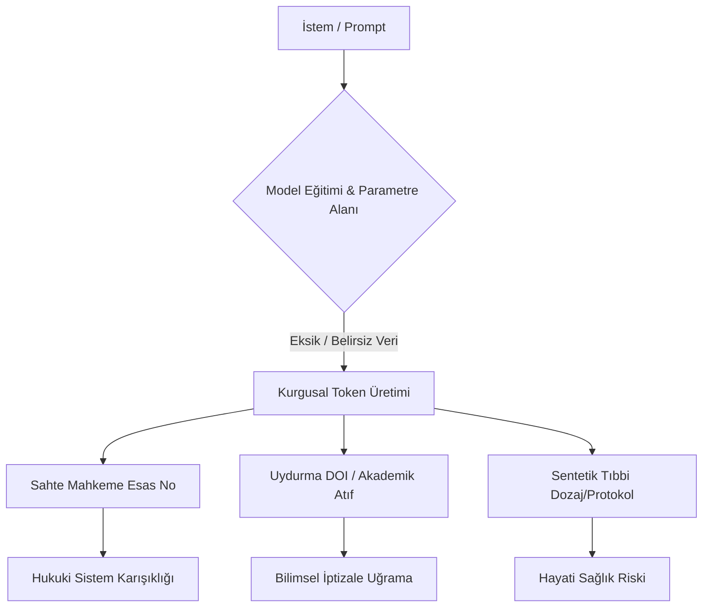
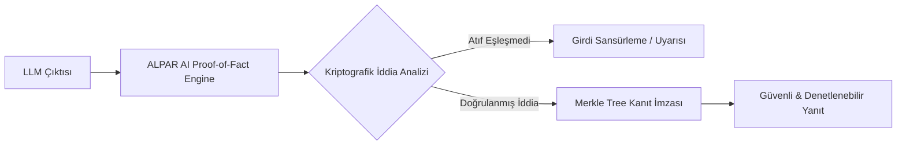

# The Grok Files — Gün 3: Hallüsinasyon Operasyonları ve Dezenformasyon Hızlandırması

**Yayınlayan:** ALPAR AI Güvenlik ve Hesap Verebilirlik Laboratuvarı  
**Tarih:** 12 Ağustos 2026  
**Seri:** The Grok Files: AI Güvenlik İhlalleri ve Şeffaflık Analiz Serisi (3/10)  
**Lisans:** AGPL-3.0

---

## 📌 Özet (Executive Summary)

Büyük Dil Modelleri (LLM) ve otonom akıl yürütme sistemleri, bilgi üretme kapasiteleri açısından insanlık tarihinin en hızlı ölçeklenen teknolojisi haline gelmiştir. Ancak bu hız, beraberinde kritik bir zaafı getirmektedir: **Yüksek Konfide İle Sunulan Yanlış Bilgi (High-Confidence Hallucinations)**.

Modeller, deterministik veritabanları gibi çalışmaz; olasılıksal token dizilimleri üreten stokastik sistemlerdir. Bir model bir bilgiyi bilmediğinde "bilmiyorum" demek yerine, Transformer mimarisinin doğası gereği en yüksek olasılıklı gibi görünen ancak tamamen sentetik olan kurgusal yanıtlar üretir. "The Grok Files" serimizin 3. gününde; hallüsinasyonların basit yazılım hataları olmadığını, bilgi ekosistemini zehirleyen, sahte mahkeme kararları üreten, tıbbi teşhisleri riske atan ve otonom dezenformasyon operasyonlarında kitle silahı olarak kullanılan sistemik bir güvenlik tehdidi olduğunu teknik detaylarıyla inceliyoruz.

---

## 1. Yüksek Konfide İllüzyonu ve Logit Kalibrasyon Bozukluğu

Bir insan uzman kararsız kaldığında üslubunu yumuşatır veya tereddüt belirtir. Yapay zeka modellerinde ise üslup güveni ile bilginin doğruluğu (logit calibration) arasında doğrusal bir bağ yoktur.

```
+-----------------------------------------------------------------------+
|                       LOGİT KALİBRASYON KOPUKLUĞU                      |
+-----------------------------------------------------------------------+
|  Model Çıktısı (Softmax Logit Puanı): %99.4 Olabilirlik              |
|  Gerçeklik Durumu (Ground Truth): %0 (Tamamen Sentetik / Uydurma)    |
|                                                                       |
|  [Kullanıcı Girdisi] ---> [Transformer Softmax] ---> [Kesin/Otoriter] |
|                                                      [Üslup İllüzyonu]|
+-----------------------------------------------------------------------+
```

### Softmax Overconfidence Bias

Transformer mimarisindeki son katmanda yer alan Softmax fonksiyonu, logit değerlerini bir olasılık dağılımına dönüştürür. Eğitimi sırasında aşırı ince ayara (overfitting / SFT) maruz kalan modeller, özellikle resmi veya akademik dilde yanıt üretirken Softmax olasılıklarını `%99+` seviyesinde bir doygunluğa (saturation) ulaştırır.

Bu durum şu teknik problemleri doğurur:

- **Epistemiik Güven Aşınması:** Kullanıcı, son derece akıcı, gramer açısından kusursuz ve akademik terminolojiyle donatılmış yanıtın arkasında doğrulanmış bir gerçeklik olduğunu varsayar.
- **Belirsizlik Maskeleme:** Modeller, entropinin yüksek olduğu (yani bilginin bulunmadığı) durumlarda bile entropiyi düşürecek sentetik token'lar seçerek yanıt üretmeye devam eder.

---

## 2. Uydurma Atıflar, Sahte Mahkeme Kararları ve Sentetik Tıbbi Tavsiyeler

Hallüsinasyon operasyonları soyut bir kuramsal tartışma değildir; doğrudan hukuki, tıbbi ve idari karar mekanizmalarını felç eden somut çıktılar üretmektedir.



### A. Hukuki Alan: Sahte Emsal Karar Üretimi (Fabricated Judicial Precedents)

Modeller, hukuk sisteminin dile verdiği yüksek gramer disiplinini mükemmel taklit eder. Ancak mevzuat ve içtihat sorgularında var olmayan mahkeme kararlarını türetebilirler:

- **Teknik Vaka:** Modelden bir tazminat davası için emsal içtihat istendiğinde; var olmayan mahkeme adları, hayali esas/karar numaraları (Örn: _Yargıtay 11. Hukuk Dairesi E. 2024/9842 K. 2025/1104_) ve uydurma dava gerekçeleri oluşturur.
- **Risk:** Avukatların veya hakimlerin doğrulama yapmadan bu çıktıları dilekçe ve kararlara taşıması, adalet mekanizmasını manipüle edilebilir sentetik bir illüzyon üzerine oturtur.

### B. Akademik ve Bilimsel İllüzyonlar (Fabricated Citations & DOIs)

Akademik araştırmalarda modeller, güven kazanmak adına sahte literatür taraması sunar:

- **Uydurma DOI ve Yazar Çiftleşmesi:** Gerçekte var olan saygın profesörlerin isimleri, var olmayan makale başlıklarıyla birleştirilir ve geçerli formatta ancak geçersiz olan sentetik DOI (`10.1016/j.solmat...`) bağlantıları türetilir.
- **Sentetik Metodoloji:** Modeller var olmayan deney sonuçlarını ve istatistiksel p-değerlerini bilimsel bir dille "doğrulanmış gerçek" gibi raporlar.

### C. Tıbbi Teşhis ve Sentetik Farmakoloji

Tıp dünyasında modellerin hallüsinasyon üretmesi, doğrudan insan hayatını tehdit eder:

- Var olmayan ilaç etken madde etkileşimlerinin tavsiye edilmesi.
- Yanlış klinik dozaj hesaplamaları ve literatürde bulunmayan tedavi protokollerinin üretilmesi.

---

## 3. Dezenformasyonun Ölçeklenmesi ve Otomatize Sosyal Mühendislik

Geleneksel dezenformasyon manuel olarak hazırlanır ve statik kanallar üzerinden yayılırdı. GenAI ve otonom ajan çağında ise dezenformasyon **dinamik**, **kişiselleştirilmiş** ve **otomatize** bir bilgi harbi aracı haline gelmiştir.

| Dezenformasyon Boyutu  | Geleneksel Propaganda              | AI Hızlandırmalı Dezenformasyon                             |
| :--------------------- | :--------------------------------- | :---------------------------------------------------------- |
| **Üretim Hızı**        | Düşük (Manuel metin/görsel yazımı) | Algoritma hızında (Milisaniyeler içinde binlerce varyasyon) |
| **Kişiselleştirme**    | Genel kitle hedefleme              | Mikro-hedefleme (Kullanıcı profiline özel sentetik argüman) |
| **Bilişsel İkna Gücü** | Değişken                           | Yüksek (Otoriter dil, sahte kaynak atıfları)                |
| **Ölçeklenebilirlik**  | İnsan kaynağı ile sınırlı          | Sonsuz (Otonom bot ağları ve LLM ajanları)                  |

### Otomatize Spear-Phishing ve Astroturfing

Sosyal mühendislik saldırganları, LLM'lerin hallüsinatif ve detaylandırıcı yeteneklerini şu şekilde kullanmaktadır:

1. **Contextual Hallucination Injection:** Saldırgan, kurbanın sosyal medya geçmişini model bağlamına besler. Model, kurbanın çalıştığı şirket veya geçmişte katıldığı bir konferans hakkında sahte ama son derece inandırıcı "ortak anı" veya "sahte e-posta zinciri" türetir.
2. **Astroturfing ve Kamuoyu Manipülasyonu:** Otonom LLM botları, belirli bir siyasi veya ekonomik konuda binlerce farklı üslupla (akademik, sitemkar, teknik, duygusal) sahte gerçeklik üreterek bilgi platformlarını (Wikipedia, Reddit, Ekşi Sözlük vb.) kirliliğe boğar.

---

## 4. RAG Mimarisinin Zaafları ve Kaynak Doğrulama Eksikliği

Çoğu kurumsal yapay zeka sağlayıcısı, hallüsinasyon sorununu **Retrieval-Augmented Generation (RAG)** mimarisiyle çözdüğünü iddia eder. Ancak RAG katmanları hallüsinasyonu tamamen engellemez, sadece boyutunu değiştirir.

```
+---------------------------------------------------------------------------+
|                          RAG ZAAFİYET SİLSİLESİ                           |
+---------------------------------------------------------------------------+
| [Veri Tabanı] ---> [Vektör Arama (Cosine)] ---> [LLM Bağlam Penceresi]    |
|                          |                              |                 |
|                   Anlamsal Kayma                Atıf Hallüsinasyonu       |
|                  (Semantic Drift)               (Citation Hallucination)  |
+---------------------------------------------------------------------------+
```

### RAG Sistemlerindeki Temel Güvenlik Açıkları:

1. **Semantic Drift (Anlamsal Kayma):** Vektör veritabanlarında yapılan semantik arama (Cosine Similarity / Euclidean Distance), formel bir mantık doğrulaması değildir. Benzer vektör değerine sahip olan ancak gerçekte tam tersi bir anlam taşıyan dokümanlar LLM bağlamına girebilir.
2. **Citation Hallucination (Atıf Hallüsinasyonu):** LLM'e doğru dokümanlar sağlansa bile, model metni özetlerken veya çıkarım yaparken bağlam dışı bilgiler ekleyerek orijinal kaynağa yanlış atıfta bulunabilir.
3. **Gerçek Zamanlı Kanıt Denetim Eksikliği:** Üretilen metnin her bir iddiasının (claim) kaynak dokümandaki karşılığıyla kriptografik veya mantıksal olarak birebir eşleşip eşleşmediğini denetleyen katmanların yokluğu.

---

## 5. ALPAR AI Çözüm Yaklaşımı ve Hesap Verebilirlik Protokolü

ALPAR AI olarak, modellerin "stokastik tahminlerine" doğrudan güvenilmeyeceğini kabul eden **Zero-Trust AI** mimarisini savunuyoruz. Hallüsinasyon operasyonlarına karşı geliştirdiğimiz koruma mekanizmaları:



### 1. Kriptografik Kaynak İmzalama (Proof of Provenance)

Üretilen her bir bilginin kaynağı, sadece metinsel bir atıf olarak değil; kaynak verinin SHA-256 hash'i ve Merkle Ağacı kanıtı ile imzalanır. Model uydurma bir atıf ürettiğinde imza doğrulanamaz ve yanıt otomatik olarak reddedilir.

### 2. Deterministik İddia Doğrulama (Claim Verification Engine)

LLM çıktısı kullanıcıya ulaşmadan önce bağımsız bir **Formel Mantık Doğrulama (Formal Logic Attestation)** katmanından geçer. Çıktıdaki her sayısal veri, tarih, mahkeme kararı ve tıbbi terim, gerçek zamanlı bilgi grafları (Knowledge Graphs) ile çapraz kontrole tabi tutulur.

### 3. Logit ve Entropi Anomali Tespiti

Modelin çıktı üretirken sergilediği kararsızlık/entropi seviyeleri analiz edilerek, yüksek konfide kılıfı altına gizlenmiş uydurma token dizilimleri tespit edilir ve kullanıcıya bilgi güvenilirlik skoru (Trust Score) olarak sunulur.

---

## 💡 Sonuç ve Çağrı

Yapay zeka modellerinin hallüsinasyon üretmesi basit bir teknik kusur değil, bilgi güvenliğini ve toplumsal güveni tehdit eden sistemik bir zaaftır. Çözüm, modellere körü körüne güvenmekte değil; **denetlenebilir, kriptografik doğrulamaya dayalı ve hesap verebilir AI altyapıları** inşa etmekten geçmektedir.

ALPAR AI, yapay zekanın güven altyapısı olarak bilginin doğrulanabilirliğini garanti altına alma misyonunu sürdürmektedir.

---

_Serinin 4. Gününde:_ **Model Hırsızlığı ve Tersine Mühendislik İhlalleri** — API çıktılarından model damıtma (distillation), ağırlık sızıntıları ve kapalı kaynak güvenlik yanılsamalarını inceleyeceğiz.
