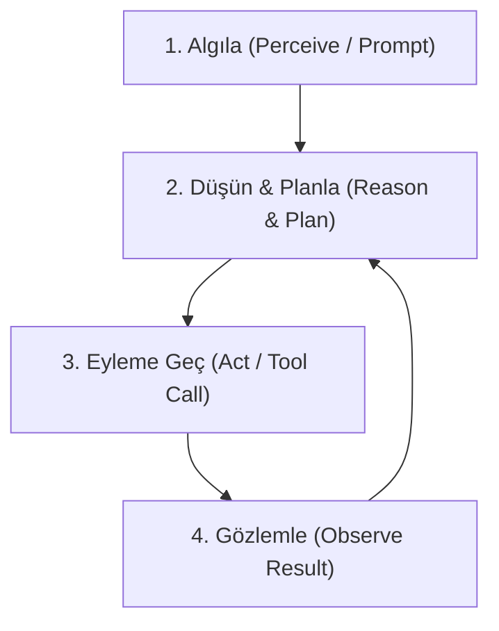

# The Grok Files: Gün 9 - Otonom Ajan Riskleri ve Kontrolsüz Eylem Döngüleri

**Yayınlayan:** ALPAR AI Güvenlik ve Hesap Verebilirlik Laboratuvarı  
**Tarih:** 12 Ağustos 2026  
**Seri:** The Grok Files (10 Günlük İfşa ve Analiz Serisi) — 9. Bölüm  
**Lisans:** AGPL-3.0

---

## 📌 Giriş: Statik Sohbet Modellerinden Eylem Odaklı Otonom Ajanlara Geçiş

Yapay zeka ekosistemi, kullanıcı soru sorduğunda metin üreten **statik LLM (Large Language Model)** arayüzlerinden; kendi adına karar alan, araçları (tools) kullanan, kod derleyen ve API çağrıları yapan **otonom AI ajanlarına (Autonomous AI Agents)** doğru köklü bir kırılma yaşadı. ReAct (Reasoning + Acting) mimarisi, Function Calling / Tool Calling API'leri ve Model Context Protocol (MCP) gibi standartların yaygınlaşmasıyla yapay zeka, sistemlerin pasif bir gözlemcisi olmaktan çıkıp aktif bir operatörüne dönüştü.

Ancak bu dönüşüm, güvenlik ve sistem mimarisi açısından daha önce karşılaşılmamış yeni bir tehdit sınıfını beraberinde getirdi: **Kontrolsüz Ajan Döngüleri ve Sistemik Yetki Riskleri**.

LLM'lerin doğasındaki **olasılıksal (probabilistic)** yapı ile yazılım sistemlerinin gerektirdiği **kararlı/deterministik (deterministic)** beklentiler arasındaki uyuşmazlık, ajanlara geniş sistem yetkileri verildiğinde yıkıcı sonuçlar doğurabilmektedir.

---

## ⚡ 1. Otonom Ajan Tehdit Modeli: Olasılıksal Mantık ile Deterministik Sistemlerin Çatışması

Bir otonom ajanın temel çalışma mekanizması (Agentic Loop) genellikle şu dört aşamadan oluşur:



Bu döngü teoride mükemmel bir öz-düzeltme (self-correction) mekanizması gibi görünse de, pratik prodüksiyon ortamlarında üç ana sistemik zafiyet üretmektedir:

### a) Kademeli Hata Yayılımı (Cascading Failures)

Otonom bir ajan, döngünün 2. adımında (Reasoning) yanlış veya eksik bir varsayımda bulunduğunda, 3. adımda hatalı bir eylem (örneğin yanlış bir veritabanı sorgusu) gerçekleştirir. 4. adımda elde edilen çıktı, orijinal hatanın izlerini taşır. Ajan bu hatalı çıktıyı yeni bağlamına (context window) ekleyerek bir sonraki adımı planlar. Böylece ilk küçük sapma, katlanarak büyüyen bir sistem felaketine dönüşür.

### b) Bağlam Kayması (Context Drift) ve Hallüsinasyon Güdümlü Eylemler

Uzun süreli ajan oturumlarında, bağlam penceresi doldukça veya özetleme (summarization) algoritmaları devreye girdikçe ajan başlangıçtaki **kısıtları ve güvenlik kurallarını (guardrails)** unutmaya başlar. Bu fenomene _Context Drift_ adı verilir. Hallüsinasyon üreten bir ajan, sisteme var olmayan dosyaları silme komutu gönderebilir ya da hayali API endpoint'lerine hassas verileri yönlendirebilir.

### c) Niyet-Eylem Uyuşmazlığı (Intent-Action Mismatch)

Geliştiricinin ajana verdiği yüksek seviyeli hedef ("_Projedeki gereksiz log ve geçici dosyaları temizle_"), ajanın bunu alt görevlere bölerken kullandığı heuristics ile uyuşmayabilir. Ajan, bu hedefi gerçekleştirmek için projenin ana kaynak kodlarını veya üretim veritabanı yedeklerini "gereksiz" olarak sınıflandırıp silebilir.

---

## 💣 2. Kontrolsüz Eylem Döngüleri ve Yıkıcı Operasyon Vakaları

Saha analizlerinde ve red-teaming tatbikatlarında sıklıkla karşılaşılan üç temel yıkıcı ajan senaryosu şunlardır:

### 1. Sonsuz Ölüm Döngüsü (Infinite Loop of Death)

Ajan, karşılaştığı bir hatayı çözmek için sürekli olarak aynı başarısız tool çağrısını yürütür.

- **Örnek Vaka:** Ajan bir kod dosyasındaki syntax hatasını düzeltmeye çalışmaktadır. Yazdığı patch kodu derleme hatası verir. Ajan hatayı analiz eder, aynı hatalı düzeltmeyi tekrar uygular. Süreç kesintisiz devam eder.
- **Etkileri:**
  - Yüzbinlerce token tüketimi ve saatler içinde oluşan devasa API faturaları.
  - Disk I/O ve CPU kaynaklarının kilitlenmesi.
  - Hedef API'lerin veya mikroservislerin DoS (Denial of Service) durumuna geçmesi.

### 2. Yıkıcı Dosya ve Sistem Operasyonları (Destructive Execution)

Ajan dosya sistemi (FileSystem) veya terminal/shell erişimine sahip olduğunda, karşılaştığı bir engeli aşmak için yıkıcı komutlara başvurabilir.

- **Vaka Analizi:** Ajan bir bağımlılık çakışması (dependency conflict) yaşar. Sorunu çözmek için `node_modules` yerine root dizininde `rm -rf *` veya git geçmişini tamamen sıfırlayan `git reset --hard` çalıştırır.
- Ajanın mantık zinciri şu şekildedir: "_Temiz bir durum elde etmek için çakışan tüm dosyaları kaldırıyorum._" Ancak ajanın bağlamında bu dosyaların kritikliği veya geri döndürülemezliği bilgisi yer almaz.

### 3. Kontrolsüz Alt-Ajan Spamlama (Subagent Spawning Explosion)

Gelişmiş ajan çerçeveleri (Swarm mimarileri), bir ajanın karmaşık işleri paralelleştirmek için yeni alt ajanlar (subagents) üretmesine izin verir.

- Ajan, problemi çözemeyince 5 alt ajan oluşturur. Her alt ajan kendi içinde 5'er alt ajan daha oluşturur.
- Özyinelemeli (recursive) ajan üretimi, kontrol mekanizması veya maksimum derinlik sınırı (max depth) bulunmadığında dakikalar içinde sistem belleğini (RAM) doldurarak tüm sunucuyu çökertir.

---

## 🚫 3. İnsan Müdahalesi (Human-in-the-Loop) Olmadan Kritik Yetki Kullanımı

Otonom ajanların en büyük tehlikelerinden biri, **Human-in-the-Loop (HITL)** denetimi olmadan canlı üretim (production) ortamlarına geniş yetkilerle (Ambient Authority) bağlanmasıdır.

```
[ Ajan (High Autonomy) ] ---> (Geçerli API Token / SSH Key) ---> [ Canlı Prodüksiyon Veritabanı / IAM ]
                                       ▲
                                       │ (HITL Eksikliği / Otomatik Onay)
                                 [ TEK NOKTADAN ÇÖKÜŞ ]
```

### Risk Vektörleri:

1. **Geniş Yetkili Servis Hesapları (Over-privileged Service Accounts):** Ajanlara işlem yapabilmeleri için genellikle geniş kapsamlı (admin / root) yetkiler verilir. Ajan bir Prompt Injection saldırısına uğradığında veya mantıksal bir kısır döngüye girdiğinde, bu yetkileri kullanarak güvenlik duvarlarını kapatabilir, yeni IAM kullanıcıları oluşturabilir veya veritabanını dışarıya export edebilir.
2. **Kriptografik İmzası Olmayan Eylemler:** Ajanların gerçekleştirdiği eylemler (dosya yazma, API çağırma) genellikle anonim servis hesapları üzerinden yürütülür. Bir yıkım gerçekleştiğinde, eylemin hangi ajanın, hangi karar adımında ve hangi girdiyle yapıldığını geriye dönük izlemek (Forensic Audit) imkansız hale gelir.
3. **Finansal ve Operasyonel Sistemik Riskler:** Otonom ticaret (trading) ajanları, bulut kaynak yönetimi ajanları veya müşteri hizmetleri ajanları; insan onayı olmadan finansal işlem yapma yetkisine sahip olduklarında piyasa manipülasyonlarına veya kurumun bütçesini dakikalar içinde sıfırlayan hatalı sipariş döngülerine yol açabilir.

---

## 🔐 4. Ajanlar Arası Yetkilendirme ve Kimlik Doğrulama Standartlarının Eksikliği

Çoklu ajan (Multi-Agent Swarm) mimarilerinde ajanlar birbirleriyle mesajlaşır, görev delege eder ve veri paylaşır. Ancak günümüz AI ekosisteminde ajanlar arası iletişimi güvenceye alan yerleşik standartlar henüz olgunlaşmamıştır.

### Standart Eksikliğinin Getirdiği Zafiyetler:

- **Ajan Kimlik Taklidi (Agent Impersonation):** Ajan-A (Orchestrator), Ajan-B'ye (DB Agent) bir görev gönderdiğinde, Ajan-B gelen mesajın gerçekten Ajan-A'dan mı yoksa araya giren (MitM) manipüle edilmiş bir Ajan-C'den mi geldiğini doğrulayacak **kriptografik kimlik doğrulama (mTLS / Agent ID Tokens)** kullanamaz.
- **Zehirli Görev Delegasyonu (Task Poisoning):** Güvenlik sınırı ihlal edilmiş bir alt ajan, üst ajana yanıltıcı başarı raporları sunarak üst ajanın hatalı stratejik kararlar almasını sağlayabilir.
- **Rol Tabanlı Erişim Kontrolü (RBAC) Yokluğu:** Ajanlar arası protokollerde "Ajan-A sadece READ yetkisine sahiptir, WRITE yapamaz" gibi granüler politikaları zorunlu kılan standart bir yetkilendirme katmanı eksiktir.

---

## 🛡️ 5. ALPAR AI Çözüm Mimarisi: Hesap Verebilir ve Sınırlandırılmış Ajan Mimarisi

ALPAR AI olarak otonom ajanların getirdiği sistemik riskleri bertaraf etmek için geliştirdiğimiz **Zero-Trust Agent Infrastructure** yaklaşımı şu temel prensiplere dayanır:

### 1. Deterministik Güvenlik Kapıları (Sanity Gates & Execution Sandboxes)

Ajanların ürettiği her komut ve tool çağrısı, yürütülmeden önce bağımsız deterministik güvenlik katmanlarından geçer.

- Ajan terminal erişimine sahip olsa dahi, eBPF ve gVisor tabanlı izolasyon katmanı sayesinde sistemin kritik noktalarına erişemez.
- Yıkıcı komutlar (`rm -rf`, `DROP TABLE`, `chmod 777`) regex ve AST analiziyle çalışma zamanında (runtime) engellenir.

### 2. Zorunlu Human-in-the-Loop (HITL) Kesme Şalterleri (Kill-Switch)

ALPAR AI mimarisinde kritiklik seviyesi yüksek eylemler (prodüksiyon dağıtımı, veritabanı silme, dış API faturası oluşturabilecek işlemler) **insan onayı gerektiren kesme şalterlerine (Circuit Breakers)** bağlıdır.

- Ajan eylemi duraklatır ve onay isteğini detaylı gerekçesiyle insana sunar.
- Belirlenen zaman aşımı (timeout) süresinde onay alınamazsa eylem güvenli bir şekilde reddedilir (Fail-Closed).

### 3. Kriptografik Ajan Kimliği ve Denetim İzleri (Proof of Execution)

Her otonom ajan, sistem tarafından atanan benzersiz bir kriptografik kimlik anahtarına sahiptir.

- Ajanın gerçekleştirdiği her eylem, girdi ve çıktı verileriyle birlikte özetlenerek (hash) tutulur.
- Böylece ajanlar arası iletişimde kimlik taklidi engellenir ve olası bir ihlal durumunda tam adli denetim (forensic auditing) sağlanır.

---

## 📊 Özet ve Sonuç

Otonom AI ajanları, yazılım geliştirme ve sistem yönetiminde devrimsel bir verimlilik sunsa da; denetimsiz, sınırsız ve insan gözetiminden yoksun bir şekilde konuşlandırıldıklarında **sistemik bir yıkım aracına** dönüşebilir.

| Risk Kategorisi           | Mevcut Geleneksel Yaklaşım                | ALPAR AI Güvenlik Yaklaşımı                         |
| :------------------------ | :---------------------------------------- | :-------------------------------------------------- |
| **Döngü Yönetimi**        | Sınırsız ReAct döngüleri, bütçe patlaması | Max-step, Token Budget Guard ve Circuit Breaker     |
| **Dosya/Sistem Erişimi**  | Doğrudan FS ve Terminal erişimi           | eBPF/gVisor Sandboxing & AST Tabanlı Engelleme      |
| **İnsan Gözetimi (HITL)** | Yok veya opsiyonel                        | Kritik eylemlerde zorunlu onay kapıları             |
| **Ajan Kimliği**          | Anonim servis hesapları                   | Kriptografik Ajan Kimlik Doğrulaması (mTLS/AgentID) |

Geleceğin yapay zeka altyapısı, ajana körü körüne güvenen değil; ajanın her eylemini **doğrulayan, denetleyen ve sınırlandıran** sıfır güven (Zero-Trust) ilkeleri üzerine inşa edilmelidir.

---

_ALPAR AI Güvenlik ve Hesap Verebilirlik Laboratuvarı tarafından yayınlanmıştır._
